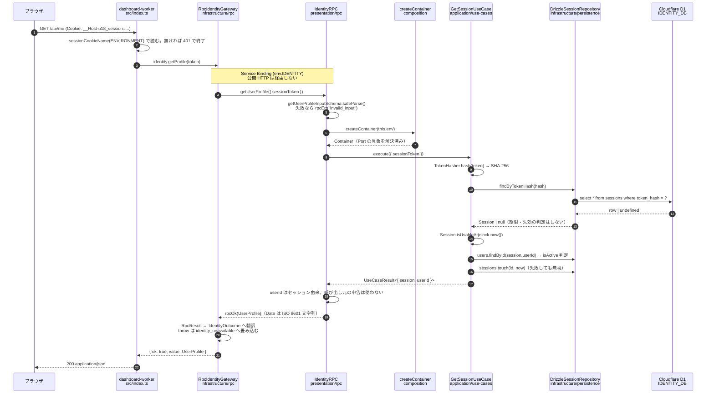

# u18 Identity — アーキテクチャ（実装版）

- Status: Living document
- Date: 2026-10-24
- 対象: このリポジトリに**現在存在するコード**
- 仕様（意図・目標）: [u18-identity-spec.md](./u18-identity-spec.md)

仕様書が「何を作るか」を定義するのに対し、本書は「いま何が建っているか」を記述する。
未実装の機能は未実装として明記する。仕様書と実装がずれている箇所は §9 に列挙する。

---

## 1. 2 つの Worker とその境界

| Worker          | ディレクトリ             | 公開入口                   | 内部 RPC                                 | D1 binding               |
| --------------- | ------------------------ | -------------------------- | ---------------------------------------- | ------------------------ |
| `u18-auth`      | `apps/auth-worker/`      | OIDC HTTP + アカウント API | `IdentityRPC` を named export            | `IDENTITY_DB` を**所有** |
| `u18-dashboard` | `apps/dashboard-worker/` | 設定 UI / BFF API          | `IDENTITY` binding で auth-worker を呼ぶ | **持たない**             |

実際の binding 定義は `apps/auth-worker/wrangler.jsonc` と
`apps/dashboard-worker/wrangler.jsonc` にある。dashboard 側の `wrangler.jsonc` には
`d1_databases` の項目自体が存在しない。

### 1.1 なぜ dashboard に D1 を渡さないのか

認証 DB への書き込み権限を 1 つの Worker に集約するため（仕様書 2.2）。

binding は「使える API」ではなく「侵害されたときに届く範囲」である。
dashboard-worker に `IDENTITY_DB` を渡した瞬間、dashboard のテンプレートインジェクション
1 つで `sessions` テーブル全体が読める。D1 binding には「このユーザーの行だけ」という
粒度が存在しないため、行レベルの認可は Worker 境界でしか作れない。

RPC 経由であれば、dashboard が行えるのは `IdentityRPC` が公開する 4 メソッドだけに限られ、
そのそれぞれが auth-worker 側で入力検証と所有者チェックを通る。
「dashboard を信用する」のではなく「dashboard に渡す鍵を小さくする」設計である。

同じ理由で、`@u18/db`（Drizzle のスキーマと `IdentityDatabase` 型）は
`apps/dashboard-worker/package.json` の依存に入っていない。依存グラフの上でも
dashboard から Identity のテーブル定義は見えない。

### 1.2 なぜ 1 つの Worker にまとめないのか

逆方向の問いも成立する。仕様書 2.2 の設計原則 1 がその答えで、
**Worker の分割はユースケース上の信頼境界で行い、層の分割では行わない**。

auth-worker は署名鍵（`SIGNING_KEY_JWK`）と Identity D1 を持つ。dashboard は
ユーザー向けの画面を出す都合上、将来的にテンプレート・外部 API・サードパーティ
スクリプトなど攻撃面の広い要素を抱えやすい。この 2 つを同じ Worker に同居させると、
画面側の脆弱性が署名鍵に直結する。分割しているのはこの 1 点のためで、
「層ごとに Worker を分ける」ような分割は行っていない。

---

## 2. Worker 内部のレイヤ構成

依存方向は `Presentation -> Application -> Domain`。
Infrastructure は Application が定義した Port を実装する（依存は Infrastructure → Application）。
`composition/` だけが両者を知り、組み立てる。

### 2.1 auth-worker

```text
apps/auth-worker/src/
├── index.ts                     Worker エントリ。default export (HTTP + scheduled) と IdentityRPC (RPC)
├── presentation/
│   ├── http/
│   │   ├── app.ts               Hono アプリ組み立て、container ミドルウェア、404/500 ハンドラ
│   │   ├── types.ts             AppBindings（Hono の型パラメータ）
│   │   ├── health.routes.ts     GET /health（DatabaseProbe 越しに D1 疎通を確認）
│   │   ├── oauth.routes.ts      Discovery / JWKS。authorize と token をマウントする
│   │   ├── oauth.authorize.routes.tsx  GET /oauth/authorize, POST /oauth/consent
│   │   ├── oauth.token.routes.ts       POST /oauth/token
│   │   ├── auth.routes.ts       Email OTP / Passkey / logout
│   │   ├── me.routes.ts         /api/me, /api/me/sessions
│   │   ├── problem.ts           エラー応答の共通形 + UseCaseError → HTTP status 変換
│   │   ├── session-cookie.ts    __Host- Cookie の読み書き
│   │   └── ui/                  Auth UI（ログイン画面・同意画面・CSP・CSRF・戻り先）
│   └── rpc/
│       └── identity.entrypoint.ts   WorkerEntrypoint 実装
├── application/
│   ├── ports/                   Port のインターフェース定義（§4 の表）
│   └── use-cases/               GetSession / ListSessions / RevokeSession /
│                                 AuthorizeRequest / IssueAuthorizationCode /
│                                 ExchangeAuthorizationCode + types.ts
├── domain/
│   ├── entities/                session.ts, user.ts, oauth-client.ts,
│   │                            authorization-code.ts, oauth-grant.ts, access-token.ts
│   ├── services/                scope.ts, token-lifetime.ts, retention-policy.ts,
│   │                            redirect-uri.ts, pkce.ts
│   └── errors/                  domain-error.ts
├── infrastructure/
│   ├── persistence/             Drizzle Repository 3 本 + DatabaseProbe
│   ├── crypto/web-crypto.ts     Web Crypto 実装 4 クラス
│   └── email/console-email-sender.ts
└── composition/container.ts     Env → 具象実装の組み立て
```

入口は 3 つある。HTTP（`default export` の `fetch`）、RPC（`IdentityRPC`）、
そして Cron Trigger（`default export` の `scheduled`）。`scheduled` は
保持期限を過ぎた行の掃除だけを行い、`PurgeExpiredRecordsUseCase` を 1 回呼ぶ
（#43、仕様書 7.3）。**掃除の経路はこの 1 本に限る。** テーブルごとに Cron を
分けると、片方だけ止まっていても誰も気づかない。テーブルごとに違う保持期間は
`domain/services/retention-policy.ts` が吸収する。

`AppBindings` が `app.ts` ではなく `types.ts` にあるのは循環参照を避けるため。
ルートが `app.ts` から型を import すると `app.ts -> *.routes.ts -> app.ts` になる。

ルート直下の `worker-configuration.d.ts` は `wrangler types` の生成物（`vars` と
binding の型）。`worker-env.d.ts` は手書きで、`wrangler types` が見ない
Workers Secret（`SIGNING_KEY_JWK` / `SIGNING_KEY_KID` / `IP_HASH_PEPPER` /
`EMAIL_API_KEY`）をグローバルな `Env` にマージする。すべて optional にしてあり、
「無ければ落とす / 既定値で進む」の判断は `composition/container.ts` が明示的に行う。

層ごとの要点:

**Presentation** — `app.ts` の `createApp()` が Hono アプリを組む。
`secureHeaders()` の直後に 1 つだけミドルウェアを置き、そこで
`c.set("container", createContainer(c.env))` を実行する。
各ルートハンドラは `c.get("container")` しか見ないので、ルートから `Env` を
直接触る経路が残らない。エラーは `problem.ts` の `problem()` で一本化し、
`statusForUseCaseError()` が Application のエラーコードを HTTP ステータスへ翻訳する。
ここが「Domain/Application のエラー語彙」と「HTTP プロトコル」の唯一の接点である。

**Application** — UseCase は 3 本。いずれも `types.ts` の
`UseCaseResult<T>`（`{ok:true,value}` / `{ok:false,error}`）を返し、例外を投げない。
注目すべきは `ListSessionsUseCase` と `RevokeSessionUseCase` が
`GetSessionUseCase` を**依存として受け取る**点で、「誰の操作か」は常に
セッショントークンから導出され、呼び出し元が申告した `userId` は受け取らない。
`RevokeSessionUseCase` は「他人のセッション」と「存在しないセッション」を
同一の `not_found` に畳み込む。区別して返すとセッション ID の実在確認に使えるため。

**Domain** — `Session` / `User` は private constructor + `fromPersistence()` のみで、
外から任意の状態を作れない。`Session.isUsableAt(now)` が失効と期限切れを 1 つの
真偽値に畳み込み、「理由を呼び出し元に返さない」方針をエンティティ側で担保する。
`domain/services/token-lifetime.ts` は仕様書 5.3 の期限値を定数化した単一の出典。
`domain/errors/domain-error.ts` の `DomainError` は HTTP ステータスも OAuth の
エラーコードも持たない。プロトコルへの翻訳は Presentation の仕事である。

**Infrastructure** — Drizzle の行型（`typeof sessions.$inferSelect`）を
Domain へ漏らさず、各 Repository の `toDomain()` が明示的に写し替える。
列を追加しても Domain が自動的に変わらないのが狙い（仕様書 7.2）。
`DrizzleSessionRepository.revoke()` は `where(and(eq(id), isNull(revokedAt)))` の
条件付き UPDATE で、同時に 2 回失効要求が来ても片方だけが行を更新する。
整合性制約を Domain のルールではなく原子的な DB 操作で保証する例（仕様書 2.3 注記）。

### 2.2 dashboard-worker

```text
apps/dashboard-worker/src/
├── index.ts                        Hono アプリ（ルート定義もここ）
├── application/ports.ts            IdentityGateway（Identity への問い合わせ Port）
├── domain/errors.ts                IdentityFailure（この Worker のエラー語彙）
└── infrastructure/rpc/identity.gateway.ts   RpcIdentityGateway（Service Binding adapter）
```

規模が小さいため `presentation/` ディレクトリは作らず、ルートは `src/index.ts` に
直接書かれている（仕様書 3 のツリーとの差分は §9-2 を参照）。層の意図自体は保たれており、
ルートハンドラは `c.get("identity")` 越しに `IdentityGateway` だけを見る。

Service Binding の型付けにも 1 つ細工がある。`wrangler types` は
相手 Worker の Entrypoint を知らないため、`env.IDENTITY` は `Fetcher` としか
型が付かない。そこで `identity.gateway.ts` の `asIdentityRpc(binding)` が
`IdentityRpcContract` へのキャストを**この 1 関数に閉じ込める**。
形の保証は呼ばれる側にあり、auth-worker の `IdentityRPC` が
`implements IdentityRpcContract` で検査されている。
型の嘘をつく場所を 1 箇所に集めておくのが狙い。

重要なのは `domain/errors.ts` の `IdentityFailure` で、
`unauthenticated` / `forbidden` / `not_found` / `identity_unavailable` の 4 種に
翻訳する。`identity_unavailable` が独立しているのは、
「セッションが無効（ログイン画面へ誘導）」と「auth-worker が落ちている（再試行を案内）」で
ユーザーへの見せ方が違うため。`RpcIdentityGateway.call()` が RPC の throw を
catch してこの区分へ畳み込むので、Presentation は 500 以外の選択肢を持てる。

---

## 3. 依存方向の強制（ESLint）

レイヤ構成は規約ではなく lint で強制されている。
実体は `packages/config/eslint.layers.js` で、ルート `eslint.config.js` が
最後に展開している（ルート側ではいったん `"no-restricted-imports": "off"` に戻してから、
層ごとに再設定する構造）。

共通の禁止リスト:

```js
const FRAMEWORKS = ["hono", "hono/*", "drizzle-orm", "drizzle-orm/*", "cloudflare:*", "@u18/db"];
```

### ブロック 1: Domain

- 対象: `apps/*/src/domain/**/*.ts`, `packages/domain/src/**/*.ts`
- 禁止: `FRAMEWORKS` 全部 + `**/application/**` + `**/infrastructure/**` + `**/presentation/**` + `**/composition/**`

Domain は「原則なにも依存しない」層なので、禁止リストが最も広い。
フレームワーク 4 種に加えて**上位層の 4 ディレクトリすべて**を塞ぐことで、
Domain から外向きの矢印が 1 本も引けないようにしている。
`cloudflare:*` が入っているのは `cloudflare:workers` / `cloudflare:test` の取り込みを
防ぐためで、これが通ると Domain が Workers ランタイムなしではテストできなくなる。
`@u18/db` の禁止は「Drizzle のテーブル型を Domain Entity として使い回さない」
（仕様書 7.2）をインポート段階で機械的に止めるもの。

### ブロック 2: Application

- 対象: `apps/*/src/application/**/*.ts`
- 禁止: `FRAMEWORKS` 全部 + `**/infrastructure/**` + `**/presentation/**` + `**/composition/**`

ブロック 1 との差は `**/application/**` が外れていることだけではなく、
**Domain への import が許されている**点。Application は Domain を使ってよく、
その下（Infrastructure の具象）と上（Presentation・組み立て）を見てはならない。
この 1 ブロックが Port/Adapter の向きを担保している。Application が
`infrastructure/` を import できてしまえば Port を定義する意味が消えるため。

### ブロック 3: Presentation

- 対象: `apps/*/src/presentation/**/*.ts`
- 禁止: `drizzle-orm`, `drizzle-orm/*`, `**/infrastructure/persistence/**`

ここだけ禁止が緩い。Presentation は Hono を使うのが仕事なので `hono` は許され、
`cloudflare:workers`（`WorkerEntrypoint`）も許される。これは
`presentation/rpc/identity.entrypoint.ts` が成立するために必要。
`composition/` の import も許される（`app.ts` と entrypoint が `createContainer` を呼ぶ）。

禁止されるのは**データアクセスの 2 経路**だけ、すなわち Drizzle を直接叩くことと、
Repository の具象クラスを直接 new すること。ルートから SQL を書く近道を塞ぐのが目的。

### 強制されていない範囲

- `infrastructure/` には制限がない。Port を実装し、フレームワークに触るのが仕事のため。
- `packages/contracts`, `packages/db`, `packages/testing` は対象外。
- 「Application が Domain を import してよい」ことの裏返しで、
  Domain → Domain の循環は lint では検出されない。

`pnpm lint` は現在クリーンに通る。

### 3.4 ルールが実際に違反を捕まえた例

ブロック 3 は机上の規約ではない。`health.routes.ts` は当初、疎通確認のために
`import { sql } from "drizzle-orm"` して `container.db.run(sql\`select 1\`)` を
直接呼んでおり、`pnpm lint` がこれを弾いた。

「ヘルスチェックくらい例外にしてよいのでは」と思える違反だが、ここを許すと
Presentation が `container.db`（Drizzle のハンドル）を触ってよい前例になり、
次に増えるのは `select 1` では済まない。採った対応は例外の追加ではなく、
**Port を 1 本足すこと**だった。

- `application/ports/health.port.ts` に `DatabaseProbe.ping(): Promise<boolean>` を定義
- `infrastructure/persistence/drizzle-database-probe.ts` に `DrizzleDatabaseProbe` を実装し、
  到達不能も例外ではなく `false` で返す（到達できないこと自体が答えなので投げ直さない）
- `composition/container.ts` で `services.databaseProbe` として配線
- ルートは `await container.services.databaseProbe.ping()` を呼ぶだけになり、
  drizzle への import が消えた

結果として、`select 1` という実装詳細が Infrastructure に移り、Presentation には
「DB に到達できるか」という意味だけが残った。lint ルールが設計の圧力として
働いた具体例として記録しておく。

---

## 4. Port / Adapter

Port は Application が「必要な操作」として定義し、Infrastructure が実装する。
`composition/container.ts` の `createContainer(env)` だけが両者を知る。

### 4.1 auth-worker

| Port（`src/application/ports/`） | 定義                                              | 実装（`src/infrastructure/`）                                                                                 |
| -------------------------------- | ------------------------------------------------- | ------------------------------------------------------------------------------------------------------------- |
| `UserRepository`                 | `user.repository.ts`                              | `DrizzleUserRepository` — `persistence/drizzle-user.repository.ts`                                            |
| `SessionRepository`              | `session.repository.ts`                           | `DrizzleSessionRepository` — `persistence/drizzle-session.repository.ts`                                      |
| `AuditLogger`                    | `audit-log.port.ts`                               | `DrizzleAuditLogger` — `persistence/drizzle-audit-logger.ts`                                                  |
| `DatabaseProbe`                  | `health.port.ts`                                  | `DrizzleDatabaseProbe` — `persistence/drizzle-database-probe.ts`                                              |
| `ExpiredRecordPurger`            | `retention.port.ts`                               | `DrizzleExpiredRecordPurger` — `persistence/drizzle-expired-record-purger.ts`                                 |
| `TokenHasher`                    | `crypto.port.ts`                                  | `Sha256TokenHasher` — `crypto/web-crypto.ts`                                                                  |
| `IpHasher`                       | `crypto.port.ts`                                  | `PepperedIpHasher` — `crypto/web-crypto.ts`                                                                   |
| `RandomTokenGenerator`           | `crypto.port.ts`                                  | `WebCryptoTokenGenerator` — `crypto/web-crypto.ts`                                                            |
| `ConstantTimeComparator`         | `crypto.port.ts`                                  | `TimingSafeComparator` — `crypto/web-crypto.ts`                                                               |
| `EmailSender`                    | `email-sender.port.ts`                            | `ConsoleEmailSender` — `email/console-email-sender.ts`（開発環境のみ）                                        |
| `Clock`                          | `clock.port.ts`（`@u18/domain` の再エクスポート） | `systemClock` — `packages/domain/src/clock.ts`                                                                |
| `EmailChallengeRepository`       | `email-challenge.repository.ts`                   | `DrizzleEmailChallengeRepository` — `persistence/drizzle-email-challenge.repository.ts`                       |
| `PasskeyRepository`              | `passkey.repository.ts`                           | `DrizzlePasskeyRepository` — `persistence/drizzle-passkey.repository.ts`                                      |
| `WebAuthnChallengeRepository`    | `webauthn-challenge.repository.ts`                | `DrizzleWebAuthnChallengeRepository` — `persistence/drizzle-webauthn-challenge.repository.ts`                 |
| `WebAuthnService`                | `webauthn.port.ts`                                | `SimpleWebAuthnService` — `webauthn/simplewebauthn.service.ts`（`@simplewebauthn/server` をここに閉じ込める） |
| `OAuthClientRepository`          | `oauth-client.repository.ts`                      | `DrizzleOAuthClientRepository` — `persistence/drizzle-oauth-client.repository.ts`                             |
| `SigningKeyProvider`             | `signing-key.port.ts`                             | `JoseSigningKeyProvider` — `crypto/jose-signing-key.ts`（`jose` をここに閉じ込める）                          |
| `AuthorizationCodeRepository`    | `authorization-code.repository.ts`                | `DrizzleAuthorizationCodeRepository` — `persistence/drizzle-authorization-code.repository.ts`                 |
| `OAuthGrantRepository`           | `oauth-grant.repository.ts`                       | `DrizzleOAuthGrantRepository` — `persistence/drizzle-oauth-grant.repository.ts`                               |
| `OAuthTokenRepository`           | `oauth-token.repository.ts`                       | `DrizzleOAuthTokenRepository` — `persistence/drizzle-oauth-token.repository.ts`                               |
| `PkceVerifier`                   | `crypto.port.ts`                                  | `WebCryptoPkceVerifier` — `crypto/web-crypto.ts`                                                              |
| `IdTokenIssuer`                  | `id-token.port.ts`                                | `JoseIdTokenIssuer` — `crypto/jose-id-token-signer.ts`（`alg` を ES256 に固定する関門）                       |

テスト用の差し替えは `apps/auth-worker/test/fakes.ts`（`InMemoryUserRepository` 等）と
`FixedClock`（`packages/domain/src/clock.ts`、`@u18/testing` からも再エクスポート）。
Mock ではなくインメモリの本物の振る舞いを置いているのは、
「呼ばれたか」ではなく「認可が効いているか」を検証するため。

Port の設計上の含意をいくつか:

- `Clock` を Port にしているのは、期限切れのテストを書けるようにするため。
  Domain / Application が `Date.now()` を直接呼ぶとその瞬間にテスト不能になる。
- `AuditLogger.record()` は失敗しても例外を投げない契約（`DrizzleAuditLogger` は
  内部で catch して `console.error` に落とす）。ログが書けないことを理由に
  ログインを拒否すると、可用性の問題がそのまま認証停止になるため。
- `AuthorizationCodeRepository` に `findByHash()` が**無い**のは設計である。
  生やすと「引いて検証してから消費する」が書けてしまい、同時に届いた 2 本の
  交換要求が両方とも検証を通りうる（仕様書 7.3）。消費は `consume()` の
  条件付き UPDATE 1 文だけに閉じている。
- `IdTokenIssuer` は `alg` を引数に取らない。`SigningKeyProvider` が
  `CryptoKey` を返すので UseCase から直接 `jose` を呼べてしまうが、そうすると
  署名アルゴリズムを選ぶコードが Application に散り、「ここだけ HS256 でも通る」
  分岐が後から生えうる（仕様書 9 はアルゴリズムの固定を要求している）。
- `PkceVerifier` を `TokenHasher` と分けているのは符号化が違うため。保存用の
  ハッシュは 16 進、`code_challenge` は base64url で、共用すると呼び出し側が
  毎回どちらの表現かを気にすることになる。
- `EmailSender` は `createContainer` で環境を見て差し替える。
  `ENVIRONMENT !== "development"` の場合、`ConsoleEmailSender` を使わず
  **起動時に throw する**。本番で OTP が Workers のログに出る事故を、
  設定漏れの段階で止めるため（メールプロバイダは仕様書 14-3 で未決）。
- 同じ考え方で、`IP_HASH_PEPPER` が未設定のとき development なら `dev-pepper`
  へ落ちるが、それ以外の環境では throw する。pepper 無しの SHA-256 は
  IPv4 空間が総当たり可能で匿名化にならず、しかも静かに既定値へ落ちると
  誰も気づけないため（仕様書 9 Privacy）。この挙動は
  `apps/auth-worker/test/security.test.ts` で検証されている。

> 以前ここに「`RandomTokenGenerator` / `ConstantTimeComparator` / `IpHasher` /
> `EmailSender` はコンテナに組み込まれているがどの UseCase も使っていない」と
> 書いてあった。#9 / #10 でログイン系が入り、4 つとも実際に使われている。
>
> `SigningKeyProvider.getActiveSigningKey()` だけは `UseCaseResult` ではなく
> **throw する**。鍵の未設定は「業務上の失敗」ではなくインフラの設定不備で、
> 呼び出し側が分岐して回復できる類ではないため。ID Token を発行する側が
> 捕まえて `err(...)` へ畳む。

### 4.2 dashboard-worker

| Port              | 定義                       | 実装                                                                |
| ----------------- | -------------------------- | ------------------------------------------------------------------- |
| `IdentityGateway` | `src/application/ports.ts` | `RpcIdentityGateway` — `src/infrastructure/rpc/identity.gateway.ts` |

Service Binding 呼び出しをこの 1 クラスに閉じ込めてあるので、将来 RPC を
HTTP 呼び出しへ置き換えても上の層は変わらない（仕様書 4.4）。

**dashboard-worker の HTTP ルートは `/account` 接頭辞ごと登録する**
（`ACCOUNT_BASE_PATH`、#106）。本番の Workers route は
`auth.under18.dev/account/*` で、Cloudflare は一致した接頭辞を URL から
取り除かない。Worker には `/account/api/me` がそのまま届くので、
`/api/me` と登録すると本番では 404 になる。`auth.under18.dev/api/me` のほうは
より短い pattern の auth-worker（`auth.under18.dev/*`）に吸われるため、
やはり dashboard には届かない。`wrangler dev` は単独オリジンで起動するので
接頭辞が無くても叩けてしまい、**壊れていても正常に見える**——
`apps/dashboard-worker/test/api.test.ts` に「接頭辞なしは 404」を固定してある。
nfc-worker も同じ対応を取っている（`CARDS_BASE_PATH`）。

### 4.3 コンテナのライフサイクル

`createContainer(env)` は**リクエストごと**に呼ばれる。Workers では `Env` が
リクエスト単位で渡るため、モジュールスコープにキャッシュできない。
生成コストはオブジェクト確保のみで、`createIdentityDatabase()` も D1 への
接続を張るわけではない（binding をラップするだけ）ので、この方針で問題ない。

`IdentityRPC` の各メソッドも、メソッドごとに `createContainer(this.env)` を呼ぶ。

---

## 5. RPC 契約境界（`packages/contracts`）

```text
packages/contracts/src/
├── errors.ts          RpcErrorCode / RpcError / RpcResult / rpcOk / rpcErr
├── identity.ts        DTO、zod スキーマ、IdentityRpcContract
├── session-cookie.ts  セッション Cookie 名（auth が発行し dashboard が読む）
├── version.ts         CONTRACT_VERSION
└── index.ts
```

このパッケージは auth-worker と dashboard-worker の両方が依存する唯一の共有境界で、
実行時依存は `zod` だけ。Hono にも Drizzle にも Cloudflare にも依存しない。

Cookie 名が「契約」に含まれるのは、RPC のメソッド署名と同じく**両 Worker が
一致していないと壊れる**ものだからである。実際、以前は dashboard 側が
開発用の名前 `u18_session` をハードコードしており、本番では
`__Host-u18_session` を永久に読めない状態になっていた。
現在は両者とも `sessionCookieName(env.ENVIRONMENT)` を呼ぶ。

`session-cookie.ts` のコメントも重要で、`__Host-` 接頭辞は
「Secure かつ Path=/ かつ **Domain 属性なし**」をブラウザに強制する。
Domain 属性を付けられない以上、この Cookie は発行したホストにしか送られず、
auth と dashboard を別ホストに置く構成では dashboard から読めない。
つまり接頭辞の選択が本番のドメイン構成（仕様書 14-1、未決）を先に縛っている。
現状の dashboard の Cookie 読み取りは「同一ホスト構成」を前提にした暫定実装である。

### 5.1 失敗を「値」で返す理由

`RpcResult<T>` は判別可能ユニオンである。

```ts
export type RpcResult<T> =
  { readonly ok: true; readonly value: T } | { readonly ok: false; readonly error: RpcError };
```

Workers の RPC は呼び出し先の戻り値を構造化クローンに近い形で運ぶ。
`Error` のサブクラスを throw しても、呼び出し元に届くときには
**プロトタイプチェーンが保たれない**。`instanceof SessionExpiredError` は常に false になり、
`error.code` のような独自プロパティも保証されない。結果として、
呼び出し側は「文字列メッセージで分岐する」という最悪の形に追い込まれる。

そこで失敗を throw ではなく値で返し、`RpcErrorCode`（`invalid_input` /
`forbidden` / `unauthenticated` / `not_found` / `rate_limited` / `internal`）という
安定した識別子で分岐させる。副次的な利点として、`RpcResult<T>` を返す関数の
戻り値は `.ok` を確かめないと `value` を読めないため、失敗の扱い忘れが
型レベルで防げる。

同じ形は Application 層の `UseCaseResult<T>`（`application/use-cases/types.ts`）
にもあり、`IdentityRPC` が両者の間で翻訳する。
auth-worker 内部のエラーコードと、外部に公開する `RpcErrorCode` を
意図的に別の型にしてあるのは、内部の都合が契約に漏れないようにするため。

### 5.2 入力検証と認可

`IdentityRPC` の 4 メソッドはすべて同じ形をしている。

1. zod スキーマ（`getSessionInputSchema` 等）で `safeParse` し、失敗すれば `invalid_input`
2. `createContainer(this.env)`
3. UseCase を実行
4. Domain Entity を DTO（ISO 8601 文字列を含む JSON 直列化可能な形）へ写す

Service Binding を持つ Worker は公開 URL なしでこれを呼べる。
つまり「内部だから安全」ではない。入力検証と認可をここで省略すると、
dashboard-worker が侵害された瞬間にそれが Identity の侵害になる（仕様書 9 補足）。

設計上最も重要なのは、**どのメソッドも `userId` を引数に取らない**こと。
`getUserProfile` でさえ `sessionToken` だけを受け取り、`userId` は
セッションから導出する。`userId` を受け取る RPC は、Binding を持つ Worker から
任意のユーザー情報を読み出せる入口そのものになる（仕様書 4.2 の注意書き）。

### 5.3 `CONTRACT_VERSION` とデプロイ順

```ts
export const CONTRACT_VERSION = "1.1.0" as const;
```

直近の更新は #18 の `listGrants` / `revokeGrant` 追加で、既存 4 メソッドの
署名・意味・DTO を変えていないため MINOR（1.0.0 → 1.1.0）。したがって
**auth-worker を先にデプロイする**。逆順にすると、新しい dashboard-worker が
まだメソッドを持たない auth-worker を呼び、Service Binding が throw する。
`RpcIdentityGateway.call()` がそれを `identity_unavailable` へ畳むので画面は
503 で済むが、同意管理だけが無言で壊れた状態がデプロイ完了まで続く。

**`IdentityRpcContract` の消費者は dashboard-worker と nfc-worker の 2 つある。**
今回はインターフェースへのメソッド追加なので、`getSession` しか使わない
nfc-worker は型も壊れず再デプロイも要らない。この非対称性は MAJOR 変更では
逆転し、両方を揃えてデプロイし直す必要が出る——「dashboard だけ直せばよい」
という前提はもう成り立たない。

2 つの Worker は独立してデプロイされるため、デプロイの瞬間に必ず
「新しい呼び出し元 × 古い呼び出し先」または「古い呼び出し元 × 新しい呼び出し先」が
一時的に成立する。契約変更時の規律は次の通り（仕様書 4.4）。

- **後方互換な追加**（メソッド追加、オプショナルフィールド追加）: MINOR を上げる。
  呼び出し先（auth-worker）を**先に**デプロイする。
- **破壊的変更**（メソッド削除、必須フィールド追加、意味の変更）: MAJOR を上げる。
  旧メソッドを最低 1 バージョン分は残したまま新メソッドを追加 →
  auth-worker をデプロイ → dashboard-worker を新メソッドへ切り替えてデプロイ →
  次のリリースで旧メソッドを削除、の 3 段階で行う。
- どちらの場合も、`IdentityRpcContract` インターフェースが型レベルの番人になる。
  `IdentityRPC` は `implements IdentityRpcContract` を宣言しているので、
  契約を満たさない変更は `pnpm typecheck` で落ちる。

`revokeSession` のような冪等でない操作に自動リトライを入れないこと。
`RpcIdentityGateway.call()` は catch するだけでリトライしない。

---

## 6. 実装済みと未実装

仕様書 12 の **Phase 1（Monorepo / Identity Core）は完了**。Phase 2（OIDC Provider）は
**認可フロー本体まで入った**。`/oauth/authorize` と `/oauth/token` が動き、
Authorization Code Flow + PKCE が端から端まで通る。残るのは
`/oauth/userinfo` と `/oauth/revoke`（#17）。

### 6.1 動くもの

| 入口                                                                              | 実体                                                                                            |
| --------------------------------------------------------------------------------- | ----------------------------------------------------------------------------------------------- |
| `GET /health`                                                                     | `health.routes.ts` → `DatabaseProbe.ping()`（D1 へ `select 1`）。失敗時は 503 + `degraded`      |
| `GET /.well-known/openid-configuration`                                           | `oauth.routes.ts`。`ISSUER` から静的に組み立てる                                                |
| `GET /oauth/authorize`                                                            | `oauth.authorize.routes.tsx` → `AuthorizeRequestUseCase` → `IssueAuthorizationCodeUseCase`      |
| `POST /oauth/consent`                                                             | 同上。同意の送信先。CSRF はログイン画面と同じ double-submit + Origin 検証                       |
| `POST /oauth/token`                                                               | `oauth.token.routes.ts` → `AuthenticateOAuthClientUseCase` → `ExchangeAuthorizationCodeUseCase` |
| `GET/POST /oauth/userinfo`                                                        | `oauth.userinfo.routes.ts` → `GetUserInfoUseCase`。Bearer 認証 + scope で claim を絞る          |
| `POST /oauth/revoke`                                                              | `oauth.revoke.routes.ts` → `RevokeAccessTokenUseCase`。RFC 7009。常に 200                       |
| `GET /api/me`                                                                     | `me.routes.ts` → `GetSessionUseCase` → `UserRepository.findById`                                |
| `GET /api/me/sessions`                                                            | `me.routes.ts` → `ListSessionsUseCase`                                                          |
| `DELETE /api/me/sessions/:id`                                                     | `me.routes.ts` → `RevokeSessionUseCase`。Origin 検証つき                                        |
| `PATCH /api/me`                                                                   | `me.routes.ts` → `UpdateProfileUseCase`。Origin 検証 + username 変更時の再認証                  |
| `GET /api/me/passkeys`                                                            | `me.routes.ts` → `ListPasskeysUseCase`。公開鍵と Credential ID は返さない                       |
| `DELETE /api/me/passkeys/:id`                                                     | `me.routes.ts` → `DeletePasskeyUseCase`。Origin 検証 + 再認証 + 所有者チェック                  |
| RPC `getSession` / `getUserProfile` / `listSessions` / `revokeSession`            | `identity.entrypoint.ts`                                                                        |
| RPC `listGrants` / `revokeGrant`                                                  | `identity.entrypoint.ts` → `ListGrantsUseCase` / `RevokeGrantUseCase`（#18）                    |
| dashboard `/account/health`, `/account/api/me`, `/account/api/me/sessions{,/:id}` | `apps/dashboard-worker/src/index.ts`。**`/account` 接頭辞が要る**（下記）                       |
| dashboard `/account/api/me/grants`, `DELETE /account/api/me/grants/:clientId`     | 同上（#18）                                                                                     |

Repository は 3 本とも実装済み（`users`, `sessions`, `audit_logs`）。
Drizzle スキーマは仕様書 7.1 の全テーブル分が `packages/db/src/schema/` に定義され、
`packages/db/drizzle/0000_fat_thunderbird.sql` として 13 テーブル分が生成済み
（`users`, `user_emails`, `passkeys`, `webauthn_challenges`, `email_challenges`,
`sessions`, `oauth_clients`, `oauth_redirect_uris`, `oauth_authorization_codes`,
`oauth_grants`, `oauth_tokens`, `signing_key_metadata`, `audit_logs`）。

### 6.2 501 Not Implemented を返すもの

`apps/auth-worker/src/presentation/http/oauth.routes.ts` の **2 本だけ**:

- `GET|POST /oauth/userinfo`（#17）
- `POST /oauth/revoke`（#17）

これ以外に 501 を返す入口は無い。以前ここに並んでいたメール OTP・Passkey・
ログアウト（#9 / #10）、JWKS（#14）、authorize と token（#15 / #16）は
すべて実装済みで、上の 6.1 に移した。

#17 が必要とする土台は `OAuthTokenRepository`（§4.1）に揃っている。
Access Token は不透明トークンなので（仕様書 14-1 の決定 5）、検証は必ず
この Port を通る —— `findByTokenHash()` で引き、可否は
`AccessToken.isUsableAt(now)` が決め、claim の絞り込みは `AccessToken.scopes` を
`filterClaimsByScope()` へ渡す。失効は `revokeByTokenHash()` が冪等に行う。

### 6.3 この状態の帰結

**ブラウザから通常の手順でログインできる。** `GET /login` がログイン画面を返し、
メール OTP なら JavaScript 無しでも、Passkey ならアイランド経由で
セッション Cookie を取得できる。`curl` だけで最後まで通ることは
`apps/auth-worker/test/login.ui.test.ts` と手動のスモークテストで確認している。

以前ここに書いてあった「`sessions` テーブルへ行を直接挿入する必要がある」は
もう当てはまらない。テストの fixture（`packages/testing/src/fixtures.ts` の
`aUser()` / `aSession()`）は引き続きその方法を使うが、それは
「ログイン経路を通らずに任意の状態を作る」ためであって、唯一の手段だからではない。

`SIGNING_KEY_JWK` / `SIGNING_KEY_KID` は `JoseSigningKeyProvider` が読む。
未設定でも**起動は止まらず**、`getActiveSigningKey()` を呼んだ時点で失敗する
（`UnconfiguredEmailSender` と同じ方針。§4.1 参照）。JWKS は秘密鍵が無くても
`signing_key_metadata` の公開鍵を返せる。

`jose` と `@simplewebauthn/server` はどちらも実際に使われている。

**OIDC の Code Flow は端から端まで通る。** `/oauth/authorize` が認可コードを
発行し、`/oauth/token` が ID Token（ES256・`kid` つき）と不透明な
Access Token を返す。ID Token は `/.well-known/jwks.json` の公開鍵で検証できる。
`curl` だけで 1 周する手順は README の「OIDC Code Flow を手元で 1 周する」にある。

認可コードの単回交換は `oauth_authorization_codes` への条件付き UPDATE 1 文で
保証している（仕様書 7.3）。これが効いていることは
`apps/auth-worker/test/oauth-code-concurrency.test.ts` が実 D1 上の 10 並列で
固定しており、実装を SELECT → 判定 → UPDATE に戻すと 10 件すべてが成功して
テストが落ちることを確認してある。

残っているのは `/oauth/userinfo` と `/oauth/revoke`（§6.2）。

---

## 7. テストの仕組み

`pnpm test` は現在すべて通る（`packages/domain` 25 件、`apps/auth-worker` 477 件、
`apps/dashboard-worker` 26 件、`apps/nfc-worker` 89 件、合計 617 件）。

### 7.1 Workers ランタイム上で走らせる

`apps/auth-worker/vitest.config.ts` は `@cloudflare/vitest-pool-workers` の
`cloudflareTest()` Vite プラグインを使う。0.23 で `defineWorkersConfig()` が
廃止されたため、通常の `defineConfig()` に `plugins: [cloudflareTest({...})]` を
渡す形になっている。これによりテスト本体が workerd の中で実行され、
`cloudflare:test` から実物の D1 binding（miniflare のローカル D1）を触れる。
Repository のテストを「本物の SQLite の挙動」で検証できるのがこの構成の目的（仕様書 11.2）。

`packages/domain` は Workers に依存しない純粋な Value Object だけなので、
素の `defineConfig()`（Node 上の vitest）で走る。これはレイヤ分割の副次的な検算にもなる。

### 7.2 マイグレーションを Node 側で読む理由

テスト本体は workerd の中なので `node:fs` が使えない。そこで役割を 2 つに割っている。

1. **`vitest.config.ts`（Node 側）** — `readD1Migrations()` で
   `packages/db/drizzle` を読み、結果を `TEST_MIGRATIONS` という binding に詰める。
2. **`test/setup.ts`（workerd 側）** — `applyD1Migrations(env.IDENTITY_DB, env.TEST_MIGRATIONS)`
   で適用する。`setupFiles` 指定なので全テストファイルの前に 1 回走る。

`test/env.d.ts` が `Cloudflare.Env` に `TEST_MIGRATIONS: D1Migration[]` を宣言して、
この binding に型を付けている。

スキーマを手書きせず生成済み SQL を流すのは、「テストと本番が同じスキーマを見ている」
ことを保証するため。`pnpm db:generate` を忘れたままスキーマを変更すると、
ここでずれが表面化する。

`test/helpers.ts` の `resetDatabase()` は行を消すだけで、マイグレーションは
再適用しない（`d1_migrations` と内部テーブルは温存する）。

### 7.3 UseCase の単体テスト

`test/fakes.ts` に `InMemoryUserRepository` / `InMemorySessionRepository` 等がある。
Mock ではなくインメモリの「本物の振る舞い」（条件付き更新の原子性を含む）を
単純化して置いてあるのは、Mock だと「呼ばれたか」しか検証できず、
認可の抜け——たとえば他人のセッションを失効できてしまう——を見逃すため。
時刻は `FixedClock` を注入する。

---

## 8. 認証済みリクエストの流れ

dashboard-worker の `GET /api/me` が成功する場合の経路。



この図で確認すべき点:

- **D1 に触れるのは最下段の 1 本だけ**で、その矢印は auth-worker の内側にしかない。
- 境界を越えるデータは `packages/contracts` の DTO のみ。`Session` や `User` の
  Entity は auth-worker の外へ出ない。
- `sessionToken` は dashboard → auth の一方向にしか流れず、auth からは
  返らない。ログにも出さない（仕様書 4.4）。
- 失敗系では `rpcErr(...)` が同じ経路を逆向きに通り、`toFailure()` で
  `IdentityFailure` になり、`statusFor()` で HTTP ステータスになる。
  例外は Worker 境界を越えない。

---

## 9. 仕様書との差分・注意点

`pnpm lint` / `pnpm typecheck` / `pnpm test` はいずれも現在グリーン。
そのうえで、実装を進めるときに把握しておくべき、仕様書 (v0.2.0) と現状コードのずれ。

1. **`packages/contracts` と RPC は Phase 2 の項目だが、既に実装されている**（仕様書 12）。
   ログイン系（Phase 1）より先に Worker 間の境界を固めた形で、
   結果として「RPC は通るがログインできない」状態になっている（§6.3）。

2. **dashboard-worker に `presentation/` ディレクトリがない**（仕様書 3 のツリー）。
   ルート定義は `src/index.ts` に直接書かれている。現状の規模では妥当だが、
   `eslint.layers.js` のブロック 3 は `apps/*/src/presentation/**` を対象にしているため、
   **dashboard のルートハンドラはレイヤ lint の対象外**である点に注意。
   presentation/ を切るときに初めてルールが効き始める。

3. **仕様書 3 のツリーに Auth UI が無い。** `presentation/http/ui/` は
   仕様書を書いた時点で想定されていなかったが、仕様書 14-4（#36）で
   「auth-worker から配信する」と決まった結果として生えている。
   クライアントアイランドのビルド工程（`scripts/build-client.mjs` と
   `tsconfig.client.json`）も同様で、ここだけ DOM 型を有効にしている。

4. **`tests/` 以下に実行されるテストは 1 本も無い**（README と適合性テストの
   記録だけ）。`pnpm-workspace.yaml` が `apps/*` と `packages/*` しか含まないので、
   ここに置いたテストはルートの `pnpm test` から走らない。
   現存するテストは `apps/auth-worker/test/`、`apps/dashboard-worker/test/`、
   `apps/nfc-worker/test/`、`packages/domain/test/` にある。

   **Worker 本体と実 D1 が要るテストは、`tests/` ではなく app の `test/` へ置く**
   という判断を 2 度続けている。単回交換の競合（#19）は
   `apps/auth-worker/test/oauth-code-concurrency.test.ts`、2 クライアント間の
   SSO（#20・Phase 2 完了条件）は `apps/auth-worker/test/sso-two-clients.test.ts`。
   どちらも auth-worker の vitest 設定（`@cloudflare/vitest-pool-workers` +
   `TEST_MIGRATIONS`）の外では走らせられず、設定を 2 つ持てば
   `compatibility_date` やマイグレーションの受け渡しが片方だけ古くなる。
   CI で走らないテストは無いのと同じなので、実行される場所を優先する。
   `tests/e2e/` を使うのは複数 Worker を同時に起動する必要が出てからでよい
   （`tests/e2e/README.md` に判断と実機手順を書いてある）。

5. **`compatibility_date` は `2026-08-15`** で、今日の日付ではない。
   `@cloudflare/vitest-pool-workers` が同梱する workerd のビルド日より後の日付を
   指定すると、テストが起動時に `ERR_FUTURE_COMPATIBILITY_DATE` で全滅する。
   上げるときは pool/miniflare も同時に上げること（README の固定バージョン節を参照）。

6. **`wrangler.jsonc` の `database_id` は `REPLACE_WITH_D1_DATABASE_ID` のまま**。
   各自が `wrangler d1 create` した ID で置き換える前提で、リポジトリには
   実 ID をコミットしていない。

7. 仕様書 2.1 の図にある nfc-worker は Phase 4 のため存在しない。
   `tsconfig.base.json` がルートと `packages/config/` の 2 箇所にあり、
   後者は前者を `extends` するだけの薄いラッパになっている。
   `packages/config/tsconfig.lib.json`（Worker ではないパッケージ用）は
   `"types": ["@cloudflare/workers-types"]` を指定する。このリポジトリの
   パッケージはすべて最終的に workerd 上で動くため、Web Crypto 等の
   ランタイム標準グローバルを型として認識させる必要がある一方、
   DOM lib や `@types/node` を足すと `window` / `document` / Node のグローバルが
   Domain 層からも見えてしまい、動かないコードが型検査を通ってしまう。

---

## 10. 関連文書

- [u18-identity-spec.md](./u18-identity-spec.md) — 要件・プロトコル仕様・フェーズ定義
- [threat-model.md](./threat-model.md) — 脅威モデル
- [runbook.md](./runbook.md) — 運用手順
- [../README.md](../README.md) — セットアップとスクリプト
