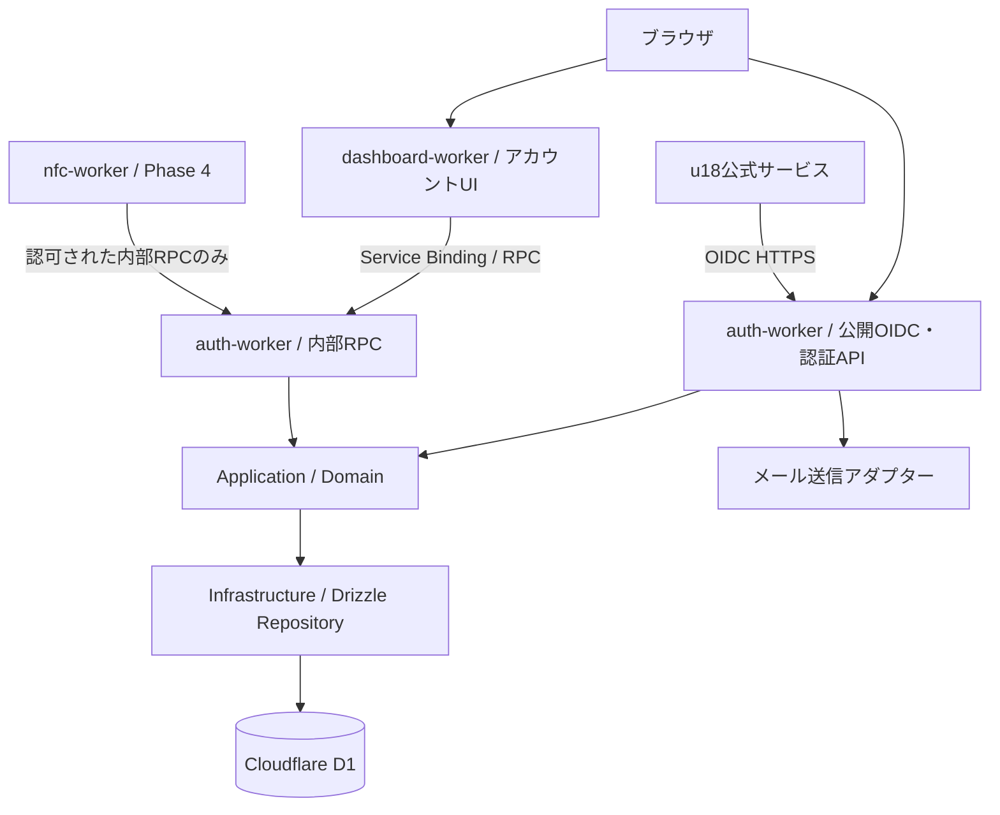

# u18 Identity — 統合認証基盤仕様書

- Status: Draft
- Version: 0.2.0
- Date: 2026-10-24
- Target: Cloudflare Workers Paid
- Architecture: pnpm Monorepo + Layered Architecture + Workers Service Bindings/RPC
- Language: TypeScript
- Database: Cloudflare D1 + Drizzle ORM

## 1. 概要

u18の複数のWebサービスで共通利用できるOpenID Connect（OIDC）Identity Providerを構築する。u18の公式サービス間でシングルサインオン（SSO）を提供し、将来的には三田学園文化祭で配布するNFCカードをu18のアカウントに紐づけ、ユーザー自身が遷移先URLを管理できるようにする。

最初のリリースでは **認証基盤の完成を優先** し、NFC連携は将来の独立したWorkerとして想定する。

### 1.1 目標

- u18公式サービスで「Sign in with u18」を実現する。
- OIDC Authorization Code Flow + PKCEによる標準的なログインを提供する。
- PasskeyとメールOTPによるパスワードレス認証を提供する。
- ユーザーがセッションとアプリへの同意を管理できるようにする。
- Cloudflare Workers上で単純な運用を維持する。
- Workerごとに責務を分離し、Service BindingsのRPCで連携する。
- Drizzle ORMとLayered Architectureを使い、テスト可能で変更に強い構造にする。

### 1.2 非目標（MVP）

- 外部開発者が**自由に**OAuthクライアントを登録する公開Developer Portal（**Developer Portal 自体は非目標ではない。決定11 の段階を参照**）
- 外部IdP（Google、GitHubなど）によるソーシャルログイン
- 組織・チーム権限管理
- NFCカードの発行・所有権移転・リダイレクト管理
- SAML対応
- Refresh Token発行（ローテーションと再利用検出の実装後に追加）

## 2. アーキテクチャ

### 2.1 全体像



### 2.2 設計原則

1. **Layered ArchitectureはWorker内部の責務分離** とする。Workerの数はユースケース上の境界で決め、層ごとにWorkerを分けない。
2. **Identityの書き込み権限はauth-workerに集約** する。dashboard-workerやnfc-workerは認証DBを直接変更しない。
3. **RPCは内部機能の公開境界**。内部通信であっても権限確認・入力検証・監査を省略しない。
4. **OIDCは公開HTTPプロトコル**。外部クライアントはService Bindingsではなく標準のHTTPSエンドポイントを使う。
5. 共通パッケージは型・契約・純粋なドメインロジックを中心とし、各Worker固有のInfrastructureをむやみに共有しない。
6. 初期段階で過剰にWorkerを分割しない。MVPは `auth-worker` と `dashboard-worker` を中心に開始し、`nfc-worker` は後から追加する。

### 2.3 Layered Architecture（各Worker）

| Layer | 主な責務 | 依存先 |
| --- | --- | --- |
| Presentation | Honoルート、OIDC HTTPエンドポイント、RPC Entrypoint、DTO検証 | Application |
| Application | ユースケース、認可判断、トランザクション境界、Port呼び出し | Domain / Ports |
| Domain | User、Session、OAuthClient等のモデル、不変条件、Domain Error | 原則なし |
| Infrastructure | Drizzle Repository、Web Crypto、メール送信、KV・D1 Adapter | Application Ports / Domain |

依存関係は `Presentation -> Application -> Domain`。InfrastructureはApplicationが定義したPortを実装し、起動時に依存性を組み立てる。DomainからHono、Drizzle、Cloudflareの`Env`を参照しない。

**注**：認可コードの単回使用やセッション失効などの整合性制約は、Domain上のルールに加えてRepository内の原子的なDB操作で保証する。

## 3. Monorepo構成

パッケージ管理は `pnpm workspaces` を採用。タスク実行はpnpm scriptsから開始し、必要になればTurborepo等を導入する。

```text
u18-identity/
├── apps/
│   ├── auth-worker/
│   │   ├── src/
│   │   │   ├── presentation/
│   │   │   │   ├── http/
│   │   │   │   │   ├── oauth.routes.ts
│   │   │   │   │   ├── auth.routes.ts
│   │   │   │   │   └── me.routes.ts
│   │   │   │   └── rpc/
│   │   │   │       └── identity.entrypoint.ts
│   │   │   ├── application/
│   │   │   │   ├── use-cases/
│   │   │   │   └── ports/
│   │   │   ├── domain/
│   │   │   │   ├── entities/
│   │   │   │   ├── services/
│   │   │   │   └── errors/
│   │   │   ├── infrastructure/
│   │   │   │   ├── persistence/
│   │   │   │   ├── crypto/
│   │   │   │   └── email/
│   │   │   ├── composition/
│   │   │   └── index.ts
│   │   ├── wrangler.jsonc
│   │   └── package.json
│   ├── dashboard-worker/
│   │   ├── src/
│   │   │   ├── presentation/
│   │   │   ├── application/
│   │   │   ├── domain/
│   │   │   ├── infrastructure/rpc/
│   │   │   └── index.ts
│   │   ├── wrangler.jsonc
│   │   └── package.json
│   └── nfc-worker/                 # Phase 4で追加
├── packages/
│   ├── contracts/                  # RPC DTO、契約、共有エラー、バージョン
│   ├── domain/                     # 本当に共有する純粋なValue Object等
│   ├── db/
│   │   ├── src/schema/
│   │   ├── drizzle/
│   │   └── drizzle.config.ts
│   ├── config/                     # ESLint、TypeScript等
│   └── testing/                    # Test helper、fixture
├── tests/
│   ├── e2e/
│   ├── oidc-conformance/
│   └── security/
├── docs/
│   ├── architecture.md
│   ├── threat-model.md
│   └── runbook.md
├── pnpm-workspace.yaml
├── package.json
└── tsconfig.base.json
```

`packages/db` はスキーマ・マイグレーションの共有用で、**直接D1へアクセスする実装はauth-workerのInfrastructureに置く**。NFC用データストアは将来的に別スキーマまたは別D1 DBへ分離可能とする。

## 4. Cloudflare Workers / RPC

### 4.1 Worker構成

| Worker | 公開入口 | 内部RPC | データアクセス |
| --- | --- | --- | --- |
| auth-worker | OIDC / Login API | セッション照会・プロフィール参照・認可済み操作 | Identity D1の所有者 |
| dashboard-worker | 設定UI / BFF API | auth-workerを呼び出す | Identity D1へ直接アクセスしない |
| nfc-worker（将来） | 固定短縮URL / NFC管理API | 必要なIdentity照会のみ | NFC専用データの所有者 |

Service BindingによるRPCは同一Cloudflareアカウント内のWorkerで利用する。RPCメソッドは公開URLがなくても、**Bindingを持つ呼び出し元から実行可能**なため、メソッドを小さく保ち、任意のUser IDを受け取って無条件に情報を返す設計を避ける。

### 4.2 RPC契約例

```ts
// packages/contracts/src/identity.ts
export type SessionSummary = {
  userId: string;
  sessionId: string;
  expiresAt: string;
};

export type GetSessionInput = {
  sessionToken: string;
};

export type GetSessionResult = SessionSummary | null;
```

```ts
// apps/auth-worker/src/presentation/rpc/identity.entrypoint.ts
import { WorkerEntrypoint } from "cloudflare:workers";
import type { GetSessionInput, GetSessionResult } from "@u18/contracts/identity";

export class IdentityRPC extends WorkerEntrypoint<Env> {
  async getSession(input: GetSessionInput): Promise<GetSessionResult> {
    // 実装時: 入力検証 -> Application UseCase -> Repository
    // セッショントークンそのものをログに記録しない。
    const useCase = createGetSessionUseCase(this.env);
    return useCase.execute(input);
  }
}
```

`createGetSessionUseCase` はcomposition層で実装する。上記は構造例であり、そのままで完結する実装ではない。

呼び出し側：

```ts
const session = await env.IDENTITY.getSession({ sessionToken });
if (!session) throw new Error("Unauthorized");
```

> 注意：単なる `userId` を受け取るRPCは本人確認の代わりにならない。セッション検証やサービス間の権限境界をApplicationで検査する。高権限メソッドは専用のNamed EntrypointとService Bindingの分離も検討する。RPCで生のCookieやTokenを受け渡す範囲は必要最低限にする。

### 4.3 Service Bindingの設定例

`apps/dashboard-worker/wrangler.jsonc`

```jsonc
{
  "$schema": "./node_modules/wrangler/config-schema.json",
  "name": "u18-dashboard",
  "main": "src/index.ts",
  "compatibility_date": "2026-10-24",
  "services": [
    {
      "binding": "IDENTITY",
      "service": "u18-auth",
      "entrypoint": "IdentityRPC"
    }
  ]
}
```

`auth-worker`側で `IdentityRPC` をnamed exportし、dashboard-workerに対して必要なRPCメソッドだけを公開する。Wranglerの型生成で両Workerの設定を参照し、RPCの型を揃える。

### 4.4 RPC運用方針

- RPCの公開DTOは `packages/contracts` に置く。
- RPCメソッドの呼び出しはInfrastructure adapterに閉じ込める。
- 呼び出し先の失敗・タイムアウト・一時的障害をApplicationで明示的に扱う。
- 冪等でない操作への無条件の自動リトライは禁止。
- RPC契約変更時は後方互換性を確認し、Workerのデプロイ順を管理する。
- User、Session、Emailなどの機密情報をトレース・ログへ記録しない。

## 5. OIDC仕様

### 5.1 対応プロトコル

- OpenID Connect Core 1.0 / Discovery
- OAuth 2.0 Authorization Code Flow
- PKCE S256必須
- `response_type=code` のみ
- Scope: `openid`, `profile`, `email`
- `state` と `nonce` の正しい生成・検証
- Redirect URI完全一致検証
- 非対称鍵によるID Token署名、JWKSによる公開鍵配布
- Confidential Clientでは適切なClient認証、Public ClientではPKCEを適用
- Access Tokenは用途に応じ不透明トークンまたはAudience制限付きJWTとして設計

### 5.2 エンドポイント

| Method | Path | 説明 |
| --- | --- | --- |
| GET | `/.well-known/openid-configuration` | Discovery |
| GET | `/.well-known/jwks.json` | JWKS |
| GET | `/oauth/authorize` | 認可開始 |
| POST | `/oauth/token` | CodeのToken交換 |
| GET/POST | `/oauth/userinfo` | Scopeに応じたユーザー情報 |
| POST | `/oauth/revoke` | 発行済みTokenの失効（サポートするToken種別を明示） |

`issuer` はu18が所有する本番ドメインで固定する。仕様例として `https://auth.u18.example` を用いるが、実際のURLではない。

### 5.3 Token / Session

| 対象 | 初期設定 | 備考 |
| --- | --- | --- |
| Authorization Code | 60秒 | DBで単回交換を原子的に保証 |
| ID Token | 5分 | `iss`, `sub`, `aud`, `exp`, `iat`, `nonce`等を正しく設定 |
| Access Token | 10分 | Scope・Audience制限、必要な失効処理 |
| Browser Session | 最大12時間 | サーバー側で失効可能、HttpOnly/Secure/SameSite |
| Email OTP | 5分 | ハッシュ保存、回数制限、単回使用 |

Refresh TokenはMVPでは発行しない。導入時はRotationと再利用検出を必須にし、Token familyの失効を設計する。

### 5.4 OIDC実装方針

- 標準プロトコルは実績あるライブラリを優先し、必要機能の対応状況を検証する。
- CloudflareのOAuth Providerライブラリを採用する場合も、OIDC Providerとして必要なID Token、Discovery、UserInfo、nonce等の適合性を別途検証する。
- 独自のJWTパーサーや暗号プリミティブを作らない。Web Cryptoおよび検証済みJOSE実装を利用する。
- 署名秘密鍵はWorkers Secret等で管理する。公開鍵のkidローテーションと旧鍵の猶予期間を設計する。

## 6. ユーザー認証

### 6.1 初期方式

1. **Passkey (WebAuthn)**：推奨ログイン方式。複数Passkeyの登録・削除、適切なUser VerificationとChallenge管理を行う。
2. **Email OTP**：メールアドレス確認、補助ログイン、アカウント復旧の一部に使用。試行上限・再送制限を実装する。

Passkeyを失ったユーザーの復旧手順を公開前に定義する。管理権限を持つアカウントへの復旧はメールOTPだけに依存させず、追加の再認証・審査を設ける。

### 6.2 アカウント

```ts
type User = {
  id: string;                  // 不変の内部識別子
  username: string;
  displayName: string;
  email: string;
  emailVerified: boolean;
  status: "active" | "suspended" | "deleted";
  createdAt: string;
  updatedAt: string;
};
```

メールアドレスや`username`を認証の主キーにしない。OIDCの`sub`はIssuer内で安定したIDとする。

## 7. Drizzle / D1

### 7.1 主なテーブル

| Table | Purpose |
| --- | --- |
| `users` | ユーザー本体 |
| `user_emails` | メールアドレスと確認状態（将来の変更・複数登録に対応） |
| `passkeys` | WebAuthn Credentialの公開鍵・カウンター |
| `email_challenges` | OTPハッシュ・期限・試行回数 |
| `sessions` | セッションハッシュ・有効期限・失効 |
| `oauth_clients` | クライアント種別・登録情報 |
| `oauth_redirect_uris` | 許可されたCallback URI |
| `oauth_authorization_codes` | Codeハッシュ・Challenge・Client・Expiry・使用状態 |
| `oauth_grants` | ユーザーの同意と許可済みScope |
| `oauth_tokens` | Tokenハッシュ・状態・失効 |
| `signing_key_metadata` | kid・鍵の有効期間・公開情報（秘密鍵は保存しない） |
| `audit_logs` | セキュリティイベント |

#### メールアドレスの正本

**一意性の正本は `users.primary_email` である。`user_emails` は確認状態の台帳であって、一意性の裁定者ではない。**

当初は `user_emails` を正本に据える想定だったが、§14.1 決定 7（アカウントを物理削除せず凍結で表現する）と両立しない。`user_emails_email_unique` は**確認済みの行だけ**に効く部分インデックスであり、そこへ占有判定を預けると未確認のまま凍結されたアカウントのアドレスが解放され、BAN を回避できる。正本は自分の一意性を無条件に裁けなければならず、それができるのは `users_primary_email_unique` だけである。

2 つの索引の形が違うことは**意図して残す**。揃えるのではなく役割を分けた。

| 索引 | 形 | 答える問い |
| --- | --- | --- |
| `users_primary_email_unique` | 無条件 | このアドレスで新規アカウントを作れるか（占有。凍結アカウントも占有を保つ） |
| `user_emails_email_unique` | 確認済みの行だけ（partial） | このアドレスを 2 人が確認済みとして持っていないか（二重所有の防止。未確認の占有では他人を締め出さない） |

この分離が成り立つのは、`DrizzleUserRepository.create()` が D1 の batch で `users` → `user_emails` の順に書くためである。凍結アドレスでの再登録は 1 文目で落ち、`user_emails` の判定に到達しない。batch は暗黙のトランザクションなので、途中の文が一意制約で落ちれば先行する文も巻き戻り、`users` だけ入って台帳が欠ける状態にはならない（7.3）。

したがって次が不変条件になる。

- `users` の各行は、同じアドレスの `user_emails` 行（`is_primary = 1`）を必ず 1 本持つ。写しを書かないと `user_emails_email_unique` は守るべき行を見失い、二重所有の判定が素通りする
- `markEmailVerified()` は `users.email_verified` と `user_emails.verified_at` を同じ batch で立てる。片方だけ立てると「確認済みか」の答えが 2 通りになる
- `findByEmail()` は `users.primary_email` を引く。正本がそこにある以上、引き当ても同じ列で行う。「確認済みの別アドレスでログインする」ことは未対応で、その経路を足すときは副アドレスが `users_primary_email_unique` の占有判定に参加しないこと（= 他人の primary と衝突しうること）を先に決める必要がある

### 7.2 Repository例

```ts
// application/ports/user.repository.ts
export interface UserRepository {
  findById(id: string): Promise<User | null>;
  findByEmail(email: string): Promise<User | null>;
  save(user: User): Promise<void>;
}
```

```ts
// infrastructure/persistence/drizzle-user.repository.ts
export class DrizzleUserRepository implements UserRepository {
  constructor(private readonly db: IdentityDatabase) {}

  async findById(id: string): Promise<User | null> {
    // Drizzle queryを行いDomainへマッピングする
    throw new Error("Not implemented");
  }
  // ...
}
```

Drizzleの`schema`と`migration`は `packages/db` に集約する。一方、Repository実装はそのDBを所有するWorkerに閉じ込める。Domain EntityにDrizzleのテーブル定義を直接使い回さず、必要な変換を明示する。

### 7.3 整合性

- Authorization Codeは単回使用。条件付きUPDATE等で、同時リクエストの片方だけを成功させる。
- メールOTPの消費も原子的に行う。
- D1はSQLiteベースであることを考慮し、複数クエリの整合性に必要なDB操作を選ぶ。
- KVをセッションやCodeの正本にしない。KVは必要なら非機密キャッシュとして使う。
- データ保持・削除ポリシー、バックアップと復旧手順を定義する。

## 8. HTTP API

### 8.1 アカウント

| Method | Path | 機能 |
| --- | --- | --- |
| POST | `/api/auth/email/start` | OTP開始 |
| POST | `/api/auth/email/verify` | OTP確認 |
| POST | `/api/auth/passkeys/register/options` | 登録Challenge |
| POST | `/api/auth/passkeys/register/verify` | 登録完了 |
| POST | `/api/auth/passkeys/login/options` | 認証Challenge |
| POST | `/api/auth/passkeys/login/verify` | 認証完了 |
| POST | `/api/auth/logout` | ログアウト |
| GET | `/api/me` | 自分の情報 |
| PATCH | `/api/me` | 情報変更 |
| GET | `/api/me/sessions` | セッション一覧 |
| DELETE | `/api/me/sessions/:id` | セッション失効 |
| GET | `/api/me/passkeys` | 登録済みPasskey一覧 |
| DELETE | `/api/me/passkeys/:id` | Passkey削除 |

上記のアカウントAPIはauth-worker上に配置する。dashboard-workerからの操作は必要に応じてRPC経由で呼び出す。Cookie認証の更新系APIではCSRF対策・Originチェック・再認証を実装する。

`PATCH /api/me` で変更できるのは `displayName` と `username` のみ。`GET /api/me/passkeys` は認証器の識別に必要な項目（内部ID・ラベル・種別・登録/最終利用時刻）だけを返し、`credentialId` と公開鍵は返さない。

再認証（CSRF対策・Originチェックと併せて要求するもの）は「最後に本人確認を通してからの経過時間」で判定する。`username` の変更と Passkey の削除は、`sessions.created_at` から5分以内のセッションでのみ許可し、外れている場合は `reauthentication_required`（403）を返す。利用者はログインし直すことで再認証する。Passkeyは最後の1本も削除できる（14.1-2によりメールOTPがログイン経路として常に残るため）。

## 9. セキュリティ要求

- OIDC/OAuth: RFC 9700等の現行セキュリティ推奨に従う。Implicit Flow、Password Grantは提供しない。
- Redirect URI: 事前登録・厳密一致・HTTPS原則。例外となるローカル開発の扱いは別途定義。
- PKCE: S256必須。`code_verifier` とClient/Redirect URIの紐づけを検証。
- CSRF: `state`、ログイン・設定変更時のCSRF対策、Origin検証。
- ID Token: 署名アルゴリズム固定、`iss/aud/exp/nonce`などを検証。
- Sessions: Secure/HttpOnly/SameSite Cookie、セッション固定対策、サーバー側失効。
- WebAuthn: Origin/RP ID/Challenge/User Verification/Credential情報を検証。
- OTP: ハッシュ保存、使用済み無効化、再送・入力試行制限。
- Abuse: Rate Limiting、Turnstileをリスクに応じ適用、監査ログ。
- Infrastructure: Worker単位の最小Binding、Secretsの分離、監査可能なDeploy。
- RPC: 呼び出し元の信頼境界を明確化。権限別Entrypoint、DTO検証、操作単位の認可を実装。
- Privacy: 未成年ユーザーを想定し、学校名・生年月日・住所等の不要な属性は収集しない。情報公開範囲、削除・保持期間を明示。

**補足**：RPCは外部HTTPを経由しないが、「誰が実行してもよいメソッド」になるわけではない。Bindingを許したWorkerが侵害された場合を想定し、特に管理操作・本人情報の取得には独立した認可チェックを置く。

## 10. NFC連携（後続フェーズ）

文化祭で配布する一般的なNFCタグには固定URLを格納する。

```text
NFCタグ → https://go.u18.example/c/<random-card-id>
        → nfc-workerが所有者の設定を取得
        → 許可されたWebサイトへリダイレクト
```

- カードIDはユーザーIDとは独立し、十分なエントロピーを持つランダム識別子。
- 管理画面ではu18 Identityでログインしたユーザーが自分のカードのURLのみ変更可能。
- NFCタグ自体はログイン資格情報にしない。通常のURLタグはコピーされ得る。
- カード紛失時の無効化・所有権移転手順を設ける。
- リダイレクトは`https:`に限定し、不正・危険なURLやフィッシングへの対策を行う。
- OIDCのRedirect URIとして可変NFCリダイレクトURLを許可しない。
- カード読み取りアクセスとアカウント認証の責務を分ける。

## 11. テスト方針

### 11.1 Unit

- Domain EntityとValue Objectの不変条件
- Application UseCaseの認可判定
- Email OTP、Token、Sessionの状態遷移
- RepositoryやRPC AdapterをMockした異常系

### 11.2 Integration

- Workers VitestとローカルD1でDrizzle Repositoryを検証
- 実際のService Bindings構成でWorker間RPCを検証
- 同時認可コード交換で成功が1回に限られることを検証
- Worker間のエラー・タイムアウト・不正な入力を検証

### 11.3 E2E / Protocol

- 2つ以上の独立したOIDCクライアントでSSO
- 正常なCode Flow・PKCE、ID Token・JWKS検証
- 不正なClient/Redirect URI/Scope/PKCE/nonce/stateの拒否
- Session失効とログアウト
- Passkey登録・ログイン・紛失復旧の検証
- OIDC適合性テスト（利用可能な標準テストスイートで確認）

## 12. 実装フェーズ

### Phase 1 — Monorepo / Identity Core

- pnpm Workspaces、Cloudflare Worker構成
- Drizzle Schema、Migration、Repository
- Layered Architectureの基盤、DI/composition
- メールOTP、Passkey、セッション
- 単体・統合テスト

**完了条件**：ユーザーが登録・ログインし、自分のセッションを確認・失効できる。

### Phase 2 — OIDC Provider / RPC

- OAuth Client登録（内部管理）
- `/authorize`、`/token`、Discovery、JWKS、UserInfo
- PKCE、Consent、Scope制御
- `WorkerEntrypoint`と`packages/contracts`
- dashboard-worker -> auth-workerのRPC接続

**完了条件**：独立した2サービスから「Sign in with u18」により認証できる。

### Phase 3 — Hardening / Public Launch

- 脅威モデリング、セキュリティレビュー
- レート制限、監査ログ、鍵ローテーション
- OIDC適合性・競合・異常系テスト
- 運用手順、バックアップ、アカウント削除・復旧手順

**完了条件**：コア認証基盤を本番公開できる状態。

### Phase 4 — NFC

- nfc-worker、カード登録・所有者管理
- URL変更・無効化
- 文化祭での配布・運用手順

**完了条件**：カードを書き換えずに遷移先を変更可能で、他人のカード設定を変更できない。

## 13. MVP受け入れ基準

**根拠の強さを書き分ける。** 「本番で通した」と「テストが通る」は別物で、後者だけの項目は**本番の経路が未確認**である。#140（退避が本番で一度も走っていなかった）、#164（バックアップが復元できなかった）、#151（監査が記録されていなかった）は、いずれもテストが緑のまま本番で壊れていた。

- [x] **PasskeyとメールOTPでログインできる** — メールOTPは**本番で実測**（2026-10-25、`otp.start` → `otp.verify success` → `session.issue`）。Passkeyは `passkey.routes.test.ts` / `passkey-webauthn.test.ts` / `passkey.use-case.test.ts` が通るが、**本番の経路は未確認**（認証器の登録を伴うため）
- [x] **正常なOIDC Code Flow + PKCEが動く** — `oauth-authorize.test.ts` / `oauth-token.test.ts` / `oauth-pkce.test.ts`。加えて **`openid-client@6.8.8` による実RPライブラリとの疎通が全ケース通過**（#150）
- [x] **Authorization Codeを再利用できない** — `oauth-code-concurrency.test.ts`（同一要求の同時 2 本で成功が 1 回であることを含む）。再使用は `oauth.code.replayed` として監査に残り、保持区分は `security`（単発でも侵害の兆候のため。RFC 6749 §10.5）
- [x] **不正なClient / Redirect URI / PKCEを拒否する** — `oauth-client.redirect-uri.test.ts` / `oauth-pkce.test.ts` / `oauth-client.use-case.test.ts`。適合性スイート Basic OP で**実バグ 0 件**（#28）
- [x] **ID Tokenの署名とClaimが検証できる** — `openid-client` が ES256 の ID Token をそのまま受理（#150）。**RS256 を広告しないことによる Config OP の失格 1 件は仕様どおり**（§14.1 決定 10）
- [x] **セッションの期限・失効がサーバー側で機能する** — **本番で実測**（2026-10-25）。ログアウト後に同じ Cookie を提示すると `401` で、応答が `"no session"` ではなく **`"session is not valid"`** だった。Cookie を消しただけでなくサーバー側で失効していることの確認になる
- [x] **2つの独立したサービスがSSOを利用できる** — `sso-two-clients.test.ts`（#124）
- [x] **dashboard-workerがService Binding/RPCでIdentityに接続する** — **本番で実測**（2026-10-25）。dashboard 経由の操作が `audit_logs.actor = 'dashboard-worker'` として残ることを確認（#149 / §14.1 決定 12）
- [x] **認証DBの書き込み権限がauth-workerに集約される** — `apps/dashboard-worker/wrangler.jsonc` に `d1_databases` が**1 つも無い**。Service Binding の宛先は `scripts/check-service-bindings.mjs` が静的に検査する（#42 / #57）
- [x] **Domain/ApplicationがCloudflare・Hono・Drizzleに直接依存しない** — **eslint で機械的に強制している**（`packages/config/eslint.layers.js`）。`hono` / `hono/*` / `drizzle-orm` / `drizzle-orm/*` / `cloudflare:*` / `@u18/db` を Domain と Application から禁じ、Presentation には `drizzle-orm` / `@u18/db` / `**/infrastructure/**` を禁じる（Presentation はフレームワークを使う層なので `hono` と `cloudflare:*` は許す）。実際に import が 1 つも無いことも確認済み
- [x] **RPCの認可・入力検証・異常系テストが通る** — `rpc-actor.test.ts` / `oauth-grants.rpc.test.ts`、dashboard 側は `rpc-caller.test.ts` / `api.test.ts`
- [x] **アカウント復旧・削除・鍵ローテーションの運用が定義される** — ランブック §4（鍵ローテーション）/ §10（アカウント復旧。§10.4 メールアドレスを失った場合、§10.5 管理者の復旧は自動化しない）/ §11（削除）
- [x] **主要なセキュリティテストとOIDC準拠確認が完了する** — 適合性スイート Config OP / Basic OP とも**実バグ 0 件**、`openid-client` 疎通も全通過（#28）。public 化後の **CodeQL 初回 9 件はすべて修正済み**（dismiss 0 件。#181 / #182 / #183）

**残件として明示しておくもの。**

> **上の 13 項目がすべて `[x]` であることと、下に並ぶものが同時に成り立つ。** 受け入れ基準は「実装されテストで確かめられていること」を見ており、**本番でその経路が一度でも通ったか**は別の問いである（だから §13 冒頭で根拠の強さを書き分けている）。

- Passkey ログインの**本番経路が一部未確認**（上記 1 項目め）。**options の発行は本番で実測済み**（2026-10-28。`rpId=under18.dev` / `userVerification=required` / `allowCredentials` 無し。デプロイ後スモークが毎回見る）。**実際の認証器での署名と検証は踏んでいない** —— 機械では踏めないので実機が要る。そもそも**本番に Passkey が 1 本も登録されていない**（`passkeys` が 0 件）ので、検証を試す相手が居ない。管理者が 0 人なのも同じ理由で整合している（決定 8 が「管理者は Passkey 必須」）
- **OIDC は入口まで本番で実測済み**（2026-10-28）。検証用の public クライアントを 1 つ登録して外から当てた:

  | 当てたもの | 結果 |
  | --- | --- |
  | 登録済み + PKCE あり（未ログイン） | `303 /login?return_to=...`（戻り先を保持） |
  | **PKCE 無し** | `303` → `?error=invalid_request&error_description=code_challenge+is+required&state=...` |
  | **`code_challenge_method=plain`** | 同上。`code_challenge_method must be S256` |
  | 未登録の `client_id` | `400` |
  | 登録と違う `redirect_uri` | `400`（**攻撃者の宛先へリダイレクトしない**） |
  | `/oauth/token` に存在しない code | `400 invalid_grant` |
  | `/oauth/userinfo` に不正なトークン | `401 invalid_token` |

  **決定 9（PKCE S256 必須）が本番で効いていることが、これで実測された。** 残るのは「ログイン後に code が出て token 交換できる」部分だけで、そこは利用者のログインが要る。

  **検証用クライアントは使用後に失効させた**（`oauth-client.mjs disable`）。失効後に同じ要求を当てると **`400`** が返ることも確認してある —— **失効が本番で効くこと**もこれで実測された。ログイン側を確認するときは、同じ手順でもう一度登録すればよい。

- **本番で OIDC を使っている RP はまだ無い。** 上記は検証用クライアントで、`oauth_grants` / `oauth_tokens` / `oauth_authorization_codes` はいずれも 0 件のまま
- **新規登録（signup）の成功分岐が本番未確認。** ログインは実測済みだが、コード入力 → アカウント作成 → `/account` 着地は踏んでいない。本番の `audit_logs` に **`user.created` が 1 件も無い**（既存のアカウントは #151 でそのイベントを足す前に作られた）ので、あの経路は実装してから一度も発火していない
- **退会（アカウント削除）が実装されていない。** 上の「アカウント復旧・削除・鍵ローテーションの**運用が定義される**」は `[x]` だが、それはランブック §11 に**手順が定義されている**という意味で、`DELETE /me` も use-case も導線も無い。**「MVP 受け入れ基準が全部埋まっている」と「利用者が自分で退会できない」は同時に成り立つ。** 実装するときは先にランブック §11.6 を読むこと

## 14. 決定事項と未決定事項

### 14.1 決定済み

| # | 論点 | 決定 | 根拠・反映先 |
| --- | --- | --- | --- |
| 1 | 本番IssuerドメインとCookie境界 | Issuerは `https://auth.under18.dev`。auth-workerとdashboard-workerを**同一ホストに載せ、dashboardは `/account/*` のパスで分離**する。WebAuthnのRP IDは `under18.dev`、検証に使うoriginは `https://auth.under18.dev` に絞る。 | セッションCookieが `__Host-` 接頭辞でDomain属性を持てず、発行ホストにしか送られないため（`packages/contracts/src/session-cookie.ts` の選択肢1）。RP IDをゾーンにするのは、IdPのホスト名を変えたときに登録済みPasskeyを失わないため。反映先は両 `wrangler.jsonc` の `env.production`。 |
| 2 | 初回登録時にPasskeyを必須にするか | **必須にしない。** メールOTPで登録・ログインでき、Passkeyは登録後に追加する方式を推奨経路として案内する。 | Passkey必須は、認証器を持たない端末からの初回登録を塞ぐ。復旧手段がメールOTPしか無い現状（6.1）で必須化すると、Passkey紛失時の導線が登録時点から詰む。 |
| 3 | Email OTP送信プロバイダ | **Cloudflare Email Sending**（`send_email` バインディング）を使う。APIキーのSecretは持たない。 | Worker外部への認証情報を増やさずに済む。`wrangler dev` では既定でシミュレートされ実送信しない。 |
| 4 | Auth UIの配信元 | **auth-workerから配信する。** `hono/jsx` でサーバーレンダリングし、Passkey操作など対話が必要な部分だけ `hono/jsx/dom` のクライアントアイランドにする（HonoXと同じ構成を、追加のメタフレームワーク無しで採る）。 | ログイン画面はセッションCookieを発行するホストと同一オリジンである必要がある。別フロントエンドに出すとCookie境界とCSRF境界が増える。 |
| 5 | Access Tokenの形式 | **不透明トークン + DB失効**。`oauth_tokens` にハッシュを保存し、`/oauth/userinfo` と `/oauth/revoke` はサーバー側で状態を見る。 | 失効が即時に効く。JWTにすると失効のためにintrospectionが別途必要になり、MVPの利点が薄い。 |
| 6 | OIDCライブラリの選定 | 既製のOIDC Providerフレームワークは採らず、**プロトコルの組み立ては自前・暗号は `jose`、WebAuthnは `@simplewebauthn/server`** に委ねる。 | 独自の暗号プリミティブ・JWTパーサは作らない（5.4）という制約は `jose` で満たせる。一方で対応するフローが `code` + PKCE のみに限られるため、Providerフレームワーク全体を抱える利点が小さい。適合性は11.3のテストで担保する。 |
| 7 | アカウント削除の表現 | **物理削除しない。** 利用者から見た「削除」は、行を残して `status` を変える凍結 / BAN / 無効化として実装する。結果としてメールアドレスは解放されず、同じアドレスでの再登録はできない。 | 監査ログとの整合、誤削除からの復旧、不正利用者の再登録防止。`User.isActive` が `status` と `deletedAt` の両方を見るため、ログイン・セッション発行・トークン発行は既に塞がっている。**凍結アカウントの保持期間は未決**で、#43 / #27 で扱う（「削除」と伝えながら無期限に保持する状態は 9 Privacy の「削除・保持期間を明示」と整合させる必要がある）。 |
| 8 | 管理者の認証と復旧 | **管理者は Passkey 必須。メールOTP単独ではログインも復旧もできない。** 一般利用者向けのMFA（TOTP等）は導入しない。 | メールOTPはメールボックスの支配権がそのままアカウントの支配権になる。一般利用者にはこの取引が妥当でも（決定2）、管理権限では割に合わない。Passkeyは `userVerification: "required"` を強制しており単体で所持＋生体/PINの2要素を満たすため、その上にTOTPを重ねる利点は薄い。ロール表現は #83 で実装済み —— `users.is_admin`（真偽値。§1.2 で組織・チーム権限管理は非目標のため、役割の列挙は持たない）、`IssueSessionUseCase` が管理者の `email_otp` セッションを拒否、`DeletePasskeyUseCase` が管理者の最後のPasskey削除を拒否、付与はPasskeyが1本以上あるアカウントにのみ（`apps/auth-worker/scripts/admin-role.mjs`）。復旧手順は `docs/runbook.md` §10.5。 |
| 9 | OIDC適合性の確認方法とPKCEの扱い | **PKCE S256必須を維持し、OIDC Basic OP の認証取得は狙わない。** 適合性は適合性スイートを自前ホストして確認し、差分を記録する（#28）。Config OP は完全に通す。Basic OP も流すが、目的は合格ではなく**落ちる理由がPKCE必須だけであることの証明**とする。 | Basic OP プランの大半は `code_challenge` を送らないため、PKCE を必須にしている限り `/authorize` で `invalid_request` になる。これはOIDC Core 1.0 がPKCEより前の仕様であることに由来する差分で、PKCE無しが正しいわけではない —— RFC 9700 §2.1.1（9 が従うと宣言している規範）はクライアント種別を問わずPKCEを要求する。認証を取るためにconfidential免除やクライアント単位フラグを入れると、**PKCE無しでも認可が成功するため防御が消えたことに気づく手段が無くなる**。また 11.3 / 13 が求めているのは「確認」であって認証の取得ではなく、公開Developer Portalを作らない（1.2 非目標）以上バッジが効く相手もいない。 |
| 10 | ID Token の署名アルゴリズムとRS256非対応 | **ES256 のみを維持する。** OpenID Connect Discovery 1.0 §3 が `id_token_signing_alg_values_supported` に「RS256 MUST be included」を課しているが、**意図的に非適合とし、記録に残す**（#112）。広告だけ RS256 を足して実際はES256でしか署名しない、という形は採らない。 | **9 が「ID Token: 署名アルゴリズム固定」を要求している。** 2つのalgを広告することはRPに選択させること＝algの多様性を導入することで、9の要求に正面から逆行する。alg confusion はOIDCで最も繰り返されてきた脆弱性の系統であり、検証側が受け入れるalgを広げれば攻撃面は広がる。またDiscoveryがRS256をMUSTにしているのは「任意のRPが任意のOPのトークンを検証できる」相互運用の保証のためだが、1.2で外部開発者向けDeveloper Portalを非目標としクライアントは内部管理のみ（#13）である以上、その保証の受益者が存在しない。加えてrunbook §4のローテーション手順は1鍵1algを前提にしており、RSA鍵を足すと鍵運用——最も事故が起きやすい領域——が2系統になる。**将来RPを外部へ開く場合（#39）は再検討する。** |
| 11 | 外部Developer Portalを公開するか | **最終的には公開する。ただし段階を踏む。** (1) 現在——クライアントは内部管理のみ（#13、runbook §9 の手順で運用者が登録）。(2) 次——**Developerロール / 権限を付与した利用者だけ**がOAuthクライアントを登録できる。(3) 将来——公開。**決定9 と決定10 は (1)(2) の間は成立し続けるが、(3) に進むときは両方を再検討する**（#39）。 | 1.2 が非目標に挙げていたのは「外部開発者が**自由に**登録する公開ポータル」であって、Developer Portal そのものではない。誰でも登録できる状態は、OAuthクライアントの素性を把握できなくなる点で 9 Abuse と衝突するが、**ロールで絞っている限り素性は把握できる**ため衝突しない。段階 (3) で再検討が要るのは、決定9（PKCE必須を維持しBasic OP認証を狙わない。論拠に「バッジが効く相手もいない」）と決定10（ES256のみ。論拠に「相互運用の保証の受益者が存在しない」）が、どちらも**外部RPが存在しないこと**を前提にしているため。Developerロールの実装は #83（管理者ロール）と同じ仕組みに乗せる。 |
| 12 | RPC の呼び出し元（`actor`）をどこまで信じるか | **帰属にのみ使い、認可の判断には使わない。** `audit_logs.actor` には RPC の呼び出し元 Worker 名（`dashboard-worker` / `nfc-worker` / `cron`、名乗らない場合は `unknown`）を入れる。公開 HTTP 経路では `null` のままにする。 | **Service Binding は呼び出し元の身元を運ばない。** `caller` は自己申告で、設定しているのは呼び出し元の `wrangler.jsonc` である。`ctx.props` や名前付き entrypoint を使っても設定箇所が呼び出し元側である点は変わらないため、**どの手段でも信頼の度合いは同じ**——侵害された Worker は別の Worker を名乗れる。したがって「平常時の調査で、どの Worker 経由の操作かを読む」以上の強さを持たせない。公開 HTTP で `null` にするのは、主体が `user_id` で表されるため。ここに値を入れると「利用者本人以外が動かした」という列の意味が濁る。実装とテストは #149、`RPC_CALLERS` は `packages/contracts/src/identity.ts`、`architecture.md` §5.3。本番で `session.rejected actor=dashboard-worker` / `retention.sweep actor=cron` を確認済み。 |
| 13 | 自動化対策（Turnstile）を入れるか | **入れない。** 仕様書 9 Abuse の「Turnstile をリスクに応じ適用」は、**リスクを評価したうえで適用しない**という結論も含む。自動化対策はレート制限（二層）と、各経路の設計そのもので受ける。**再検討の条件は「レート制限で止まらない濫用が実際に観測されたとき」**とし、それまでは入れない。 | **第一に、濫用の経路が既に塞がっている。** (a) レート制限が二層 —— IP 単位のバースト（60 秒窓、#21 / #117）と、アドレス単位の持続制限（`OtpPolicy.resendWindowMs` = 1 時間、行数で判定。#88）。`/oauth/authorize` と `/oauth/token` にも適用済み（#163）。(b) OTP は照合・試行加算・消費が 1 クエリの条件付き UPDATE で、同時 3 本でも成功は 1 回（7.3）。試行上限は 5 回。(c) Passkey の `/login/options` は**入力を取らず `allowCredentials` を返さない**ので、構造的に列挙できない。(d) `/start` は登録の有無・停止中・送信失敗をすべて同一応答に畳む。**CAPTCHA が追加で止めるものが残っていない。** **第二に、利用者が未成年である。** CAPTCHA は支援技術との相性が悪く、画像・音声の課題は年齢や障害によって突破率が大きく変わる。**認証の入口に置くと、失敗した本人が復旧できない** —— これは決定 2（Passkey を必須にしない）が「認証器を持たない端末からの初回登録を塞ぐ」ことを避けたのと同じ形の判断である。**守る相手を締め出す対策は、守っていることにならない。** **第三に、Turnstile は第三者への情報提供を増やす。** 認証の入口に別事業者のスクリプトを置くことになり、9 Privacy の「最小属性」と、未成年の利用実態を外部へ渡さないという前提に照らして無条件には採れない。 |
| 14 | R2 へ退避したものを何年持つか | **プレフィックスごとに分け、`audit_logs/` は 730 日（2 年）、`d1-backups/` は 90 日。** どちらもオブジェクトの経過日数で、R2 のライフサイクルルールとして設定済み（2026-10-25）。「決めない」という状態は採らない。 | **「決めない」は無期限保持と同義である。** R2 は置いたものを消さないので、保持期間を決めるまでの間だけ**本体より長く個人情報を持つ**状態になる（#174。実際に本番ダンプ 2 本が入った時点で発覚した）。D1 側には `RetentionPolicy` と `AuditRetention` があるため、**本体では消した行がバックアップには残る**——これは 9 Privacy の「削除・保持期間を明示」と整合しない。決定 7（物理削除しない）は `users` の行の話であり、バックアップを無期限に持つことまでは含意していない。<br><br>**`audit_logs/` が 2 年である理由。** R2 へ来る行は D1 の保持区分を**過ぎた**ものなので、総到達年数は「D1 の区分 + R2 の 2 年」になる。`security`（支配権が変わる操作）で **4 年**、`standard` で約 2.5 年。`AuditRetention.security` の 2 年は「侵害の発覚が数か月〜1 年遅れても、その前後を見られる」という下限として置いた値で、**退避はその窓をもう一度ぶんだけ伸ばす**のが役割である。それ以上は、保持そのものがリスクであること（消さないデータは漏れうる）と釣り合わない。R2 側だけを短くすると D1 の区分が無意味になるため、**`standard` の 180 日ではなく `security` の 2 年に合わせる。**<br><br>**`d1-backups/` が 90 日である理由。** 目的は D1 の Time Travel が **30 日・同一 DB 内**にしか戻せない穴を塞ぐこと（ランブック 12.2）。30 日では Time Travel を複製するだけで穴が埋まらず、3 倍の余裕を取って 90 日とする。**中身が `audit_logs/` より重い** —— 全利用者の平文メールアドレスを含む完全な複製で、凍結アカウントのぶんも入る。完全な複製を何か月ぶんも並べて持つのは、復旧の役に立つ量を超えると露出を増やすだけである。<br><br>**ライフサイクルルールは遡って効く。** 期間を決める前に「とりあえず」置くと既存のオブジェクトごと消える。`audit_logs/` には D1 から既に消えた行が入っているので**戻せない**。設定時点で最古のオブジェクトは 1 日であり、どちらのルールでも何も削除されないことを確認してから適用した。 |
| 15 | Web フォントをどこから読むか | **第三者ホストから読まない。システムフォントで近似し、どうしても必要なら self-host する。** 参照元の design system（`under18dev/under18dev` の `design.md`）は Inter / JetBrains Mono を Google Fonts から読んでいるが、**認証画面では採らない。** | **決定 13（Turnstile を入れない）と同じ形である。** 外部ホストからフォントを読むと、CSP に `style-src https://fonts.googleapis.com` と `font-src https://fonts.gstatic.com` を足すことになり、`@u18/web-ui` の `page-headers.ts` が 1 箇所に保っている定義を緩める。そして**ログイン画面を開いた事実が第三者へ渡る** —— 同意画面で `img-src` に外部ホストを許していないのと同じ理由（誰がどのアプリを認可しようとしたかが漏れる）で、9 Privacy の最小属性と衝突する。<br><br>**design.md が求めているのはファイルではなく性質である。** "Minimal / Modern / Technical / Typography-focused" であって「Inter であること」ではない。参照元のフォント指定自体が `"Inter", ui-sans-serif, system-ui, sans-serif` とシステムフォントへフォールバックする形なので、**そのフォールバック側を既定にしている**。<br><br>Inter が要ると判断したら `/ui/fonts/*.woff2` として self-host する。バイト数とルートは増えるが、CSP も privacy も壊さない。**第三者ホストだけは採らない。** |

### 14.2 未決定

1. 凍結アカウントの**保持期間**と、個人情報を落とす経路（決定 7 の残件）。**文言は決まった**（2026-10-28、運用者の回答「言葉だけは『削除しました』としとく」）が、**保持期間は未回答。** 落とす経路を作らなければ、氏名相当とメールアドレスを無期限に持ったまま「削除しました」と伝えることになり、§9 Privacy と食い違う。**退会を実装する時点で確認すること。****判断の所在はランブック §11.6、残件の追跡は §12.6 (2)。**
   - **`#43` / `#27` を参照していたが、どちらも CLOSED である。** あの 2 つが閉じたのは保持期限の仕組み（#43）と runbook の作成（#27）が終わったからで、**この論点が決着したからではない。** 閉じた issue を指したまま「未決定」と書いてあると、どちらが現状なのか読んだだけでは決まらない（#257）
2. 文化祭NFCの発行・失効・本人への初回紐づけの運用

> 「外部Developer Portalを将来公開するか」は**決定11 として確定した**（#39）。

## 15. 参考資料

- Cloudflare Workers RPC: https://developers.cloudflare.com/workers/runtime-apis/rpc/
- Cloudflare Service Bindings / RPC: https://developers.cloudflare.com/workers/runtime-apis/bindings/service-bindings/rpc/
- Drizzle ORM / Cloudflare D1: https://orm.drizzle.team/docs/sqlite/connect-cloudflare-d1
- OpenID Connect Core: https://openid.net/specs/openid-connect-core-1_0.html
- OAuth 2.0 Security Best Current Practice (RFC 9700): https://www.rfc-editor.org/rfc/rfc9700.html
- WebAuthn: https://www.w3.org/TR/webauthn-3/
