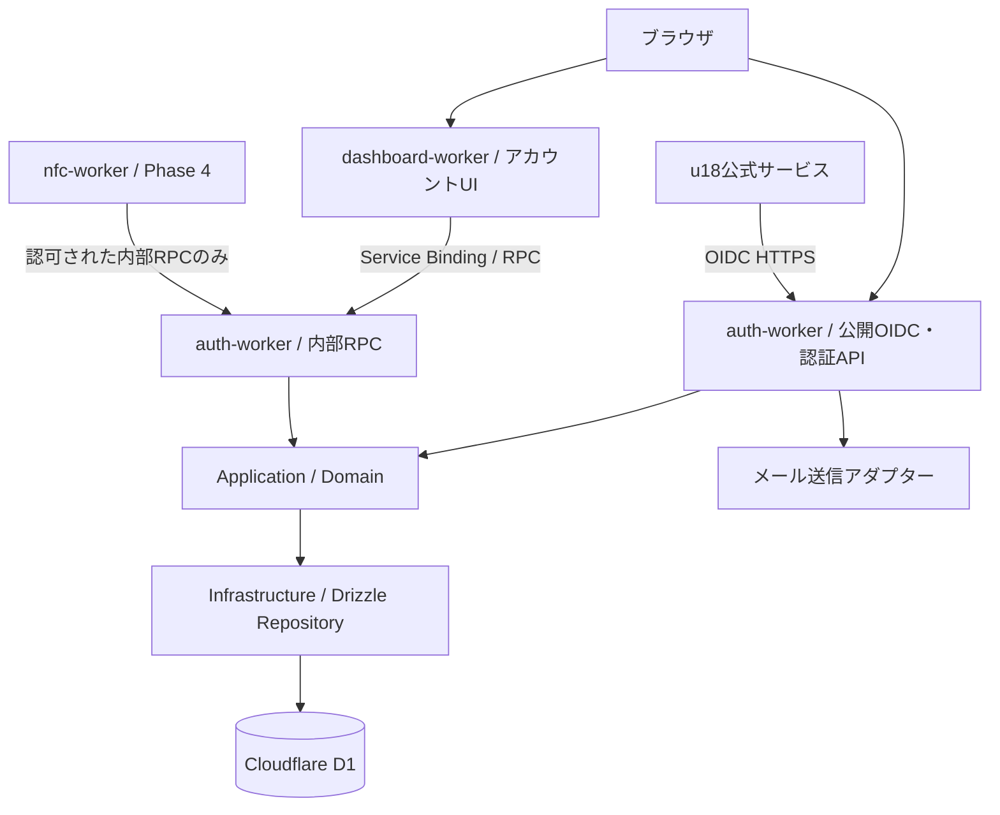

# u18 Identity — 統合認証基盤仕様書

- Status: Draft
- Version: 0.2.0
- Date: 2026-10-24
- Target: Cloudflare Workers Paid
- Architecture: pnpm Monorepo + Layered Architecture + Workers Service Bindings/RPC
- Language: TypeScript
- Database: Cloudflare D1 + Drizzle ORM

## 1. 概要

u18の複数のWebサービスで共通利用できるOpenID Connect（OIDC）Identity Providerを構築する。u18の公式サービス間でシングルサインオン（SSO）を提供し、将来的には三田学園文化祭で配布するNFCカードをu18のアカウントに紐づけ、ユーザー自身が遷移先URLを管理できるようにする。

最初のリリースでは **認証基盤の完成を優先** し、NFC連携は将来の独立したWorkerとして想定する。

### 1.1 目標

- u18公式サービスで「Sign in with u18」を実現する。
- OIDC Authorization Code Flow + PKCEによる標準的なログインを提供する。
- PasskeyとメールOTPによるパスワードレス認証を提供する。
- ユーザーがセッションとアプリへの同意を管理できるようにする。
- Cloudflare Workers上で単純な運用を維持する。
- Workerごとに責務を分離し、Service BindingsのRPCで連携する。
- Drizzle ORMとLayered Architectureを使い、テスト可能で変更に強い構造にする。

### 1.2 非目標（MVP）

- 外部開発者が自由にOAuthクライアントを登録する公開Developer Portal
- 外部IdP（Google、GitHubなど）によるソーシャルログイン
- 組織・チーム権限管理
- NFCカードの発行・所有権移転・リダイレクト管理
- SAML対応
- Refresh Token発行（ローテーションと再利用検出の実装後に追加）

## 2. アーキテクチャ

### 2.1 全体像



### 2.2 設計原則

1. **Layered ArchitectureはWorker内部の責務分離** とする。Workerの数はユースケース上の境界で決め、層ごとにWorkerを分けない。
2. **Identityの書き込み権限はauth-workerに集約** する。dashboard-workerやnfc-workerは認証DBを直接変更しない。
3. **RPCは内部機能の公開境界**。内部通信であっても権限確認・入力検証・監査を省略しない。
4. **OIDCは公開HTTPプロトコル**。外部クライアントはService Bindingsではなく標準のHTTPSエンドポイントを使う。
5. 共通パッケージは型・契約・純粋なドメインロジックを中心とし、各Worker固有のInfrastructureをむやみに共有しない。
6. 初期段階で過剰にWorkerを分割しない。MVPは `auth-worker` と `dashboard-worker` を中心に開始し、`nfc-worker` は後から追加する。

### 2.3 Layered Architecture（各Worker）

| Layer | 主な責務 | 依存先 |
| --- | --- | --- |
| Presentation | Honoルート、OIDC HTTPエンドポイント、RPC Entrypoint、DTO検証 | Application |
| Application | ユースケース、認可判断、トランザクション境界、Port呼び出し | Domain / Ports |
| Domain | User、Session、OAuthClient等のモデル、不変条件、Domain Error | 原則なし |
| Infrastructure | Drizzle Repository、Web Crypto、メール送信、KV・D1 Adapter | Application Ports / Domain |

依存関係は `Presentation -> Application -> Domain`。InfrastructureはApplicationが定義したPortを実装し、起動時に依存性を組み立てる。DomainからHono、Drizzle、Cloudflareの`Env`を参照しない。

**注**：認可コードの単回使用やセッション失効などの整合性制約は、Domain上のルールに加えてRepository内の原子的なDB操作で保証する。

## 3. Monorepo構成

パッケージ管理は `pnpm workspaces` を採用。タスク実行はpnpm scriptsから開始し、必要になればTurborepo等を導入する。

```text
u18-identity/
├── apps/
│   ├── auth-worker/
│   │   ├── src/
│   │   │   ├── presentation/
│   │   │   │   ├── http/
│   │   │   │   │   ├── oauth.routes.ts
│   │   │   │   │   ├── auth.routes.ts
│   │   │   │   │   └── me.routes.ts
│   │   │   │   └── rpc/
│   │   │   │       └── identity.entrypoint.ts
│   │   │   ├── application/
│   │   │   │   ├── use-cases/
│   │   │   │   └── ports/
│   │   │   ├── domain/
│   │   │   │   ├── entities/
│   │   │   │   ├── services/
│   │   │   │   └── errors/
│   │   │   ├── infrastructure/
│   │   │   │   ├── persistence/
│   │   │   │   ├── crypto/
│   │   │   │   └── email/
│   │   │   ├── composition/
│   │   │   └── index.ts
│   │   ├── wrangler.jsonc
│   │   └── package.json
│   ├── dashboard-worker/
│   │   ├── src/
│   │   │   ├── presentation/
│   │   │   ├── application/
│   │   │   ├── domain/
│   │   │   ├── infrastructure/rpc/
│   │   │   └── index.ts
│   │   ├── wrangler.jsonc
│   │   └── package.json
│   └── nfc-worker/                 # Phase 4で追加
├── packages/
│   ├── contracts/                  # RPC DTO、契約、共有エラー、バージョン
│   ├── domain/                     # 本当に共有する純粋なValue Object等
│   ├── db/
│   │   ├── src/schema/
│   │   ├── drizzle/
│   │   └── drizzle.config.ts
│   ├── config/                     # ESLint、TypeScript等
│   └── testing/                    # Test helper、fixture
├── tests/
│   ├── e2e/
│   ├── oidc-conformance/
│   └── security/
├── docs/
│   ├── architecture.md
│   ├── threat-model.md
│   └── runbook.md
├── pnpm-workspace.yaml
├── package.json
└── tsconfig.base.json
```

`packages/db` はスキーマ・マイグレーションの共有用で、**直接D1へアクセスする実装はauth-workerのInfrastructureに置く**。NFC用データストアは将来的に別スキーマまたは別D1 DBへ分離可能とする。

## 4. Cloudflare Workers / RPC

### 4.1 Worker構成

| Worker | 公開入口 | 内部RPC | データアクセス |
| --- | --- | --- | --- |
| auth-worker | OIDC / Login API | セッション照会・プロフィール参照・認可済み操作 | Identity D1の所有者 |
| dashboard-worker | 設定UI / BFF API | auth-workerを呼び出す | Identity D1へ直接アクセスしない |
| nfc-worker（将来） | 固定短縮URL / NFC管理API | 必要なIdentity照会のみ | NFC専用データの所有者 |

Service BindingによるRPCは同一Cloudflareアカウント内のWorkerで利用する。RPCメソッドは公開URLがなくても、**Bindingを持つ呼び出し元から実行可能**なため、メソッドを小さく保ち、任意のUser IDを受け取って無条件に情報を返す設計を避ける。

### 4.2 RPC契約例

```ts
// packages/contracts/src/identity.ts
export type SessionSummary = {
  userId: string;
  sessionId: string;
  expiresAt: string;
};

export type GetSessionInput = {
  sessionToken: string;
};

export type GetSessionResult = SessionSummary | null;
```

```ts
// apps/auth-worker/src/presentation/rpc/identity.entrypoint.ts
import { WorkerEntrypoint } from "cloudflare:workers";
import type { GetSessionInput, GetSessionResult } from "@u18/contracts/identity";

export class IdentityRPC extends WorkerEntrypoint<Env> {
  async getSession(input: GetSessionInput): Promise<GetSessionResult> {
    // 実装時: 入力検証 -> Application UseCase -> Repository
    // セッショントークンそのものをログに記録しない。
    const useCase = createGetSessionUseCase(this.env);
    return useCase.execute(input);
  }
}
```

`createGetSessionUseCase` はcomposition層で実装する。上記は構造例であり、そのままで完結する実装ではない。

呼び出し側：

```ts
const session = await env.IDENTITY.getSession({ sessionToken });
if (!session) throw new Error("Unauthorized");
```

> 注意：単なる `userId` を受け取るRPCは本人確認の代わりにならない。セッション検証やサービス間の権限境界をApplicationで検査する。高権限メソッドは専用のNamed EntrypointとService Bindingの分離も検討する。RPCで生のCookieやTokenを受け渡す範囲は必要最低限にする。

### 4.3 Service Bindingの設定例

`apps/dashboard-worker/wrangler.jsonc`

```jsonc
{
  "$schema": "./node_modules/wrangler/config-schema.json",
  "name": "u18-dashboard",
  "main": "src/index.ts",
  "compatibility_date": "2026-10-24",
  "services": [
    {
      "binding": "IDENTITY",
      "service": "u18-auth",
      "entrypoint": "IdentityRPC"
    }
  ]
}
```

`auth-worker`側で `IdentityRPC` をnamed exportし、dashboard-workerに対して必要なRPCメソッドだけを公開する。Wranglerの型生成で両Workerの設定を参照し、RPCの型を揃える。

### 4.4 RPC運用方針

- RPCの公開DTOは `packages/contracts` に置く。
- RPCメソッドの呼び出しはInfrastructure adapterに閉じ込める。
- 呼び出し先の失敗・タイムアウト・一時的障害をApplicationで明示的に扱う。
- 冪等でない操作への無条件の自動リトライは禁止。
- RPC契約変更時は後方互換性を確認し、Workerのデプロイ順を管理する。
- User、Session、Emailなどの機密情報をトレース・ログへ記録しない。

## 5. OIDC仕様

### 5.1 対応プロトコル

- OpenID Connect Core 1.0 / Discovery
- OAuth 2.0 Authorization Code Flow
- PKCE S256必須
- `response_type=code` のみ
- Scope: `openid`, `profile`, `email`
- `state` と `nonce` の正しい生成・検証
- Redirect URI完全一致検証
- 非対称鍵によるID Token署名、JWKSによる公開鍵配布
- Confidential Clientでは適切なClient認証、Public ClientではPKCEを適用
- Access Tokenは用途に応じ不透明トークンまたはAudience制限付きJWTとして設計

### 5.2 エンドポイント

| Method | Path | 説明 |
| --- | --- | --- |
| GET | `/.well-known/openid-configuration` | Discovery |
| GET | `/.well-known/jwks.json` | JWKS |
| GET | `/oauth/authorize` | 認可開始 |
| POST | `/oauth/token` | CodeのToken交換 |
| GET/POST | `/oauth/userinfo` | Scopeに応じたユーザー情報 |
| POST | `/oauth/revoke` | 発行済みTokenの失効（サポートするToken種別を明示） |

`issuer` はu18が所有する本番ドメインで固定する。仕様例として `https://auth.u18.example` を用いるが、実際のURLではない。

### 5.3 Token / Session

| 対象 | 初期設定 | 備考 |
| --- | --- | --- |
| Authorization Code | 60秒 | DBで単回交換を原子的に保証 |
| ID Token | 5分 | `iss`, `sub`, `aud`, `exp`, `iat`, `nonce`等を正しく設定 |
| Access Token | 10分 | Scope・Audience制限、必要な失効処理 |
| Browser Session | 最大12時間 | サーバー側で失効可能、HttpOnly/Secure/SameSite |
| Email OTP | 5分 | ハッシュ保存、回数制限、単回使用 |

Refresh TokenはMVPでは発行しない。導入時はRotationと再利用検出を必須にし、Token familyの失効を設計する。

### 5.4 OIDC実装方針

- 標準プロトコルは実績あるライブラリを優先し、必要機能の対応状況を検証する。
- CloudflareのOAuth Providerライブラリを採用する場合も、OIDC Providerとして必要なID Token、Discovery、UserInfo、nonce等の適合性を別途検証する。
- 独自のJWTパーサーや暗号プリミティブを作らない。Web Cryptoおよび検証済みJOSE実装を利用する。
- 署名秘密鍵はWorkers Secret等で管理する。公開鍵のkidローテーションと旧鍵の猶予期間を設計する。

## 6. ユーザー認証

### 6.1 初期方式

1. **Passkey (WebAuthn)**：推奨ログイン方式。複数Passkeyの登録・削除、適切なUser VerificationとChallenge管理を行う。
2. **Email OTP**：メールアドレス確認、補助ログイン、アカウント復旧の一部に使用。試行上限・再送制限を実装する。

Passkeyを失ったユーザーの復旧手順を公開前に定義する。管理権限を持つアカウントへの復旧はメールOTPだけに依存させず、追加の再認証・審査を設ける。

### 6.2 アカウント

```ts
type User = {
  id: string;                  // 不変の内部識別子
  username: string;
  displayName: string;
  email: string;
  emailVerified: boolean;
  status: "active" | "suspended" | "deleted";
  createdAt: string;
  updatedAt: string;
};
```

メールアドレスや`username`を認証の主キーにしない。OIDCの`sub`はIssuer内で安定したIDとする。

## 7. Drizzle / D1

### 7.1 主なテーブル

| Table | Purpose |
| --- | --- |
| `users` | ユーザー本体 |
| `user_emails` | メールアドレスと確認状態（将来の変更・複数登録に対応） |
| `passkeys` | WebAuthn Credentialの公開鍵・カウンター |
| `email_challenges` | OTPハッシュ・期限・試行回数 |
| `sessions` | セッションハッシュ・有効期限・失効 |
| `oauth_clients` | クライアント種別・登録情報 |
| `oauth_redirect_uris` | 許可されたCallback URI |
| `oauth_authorization_codes` | Codeハッシュ・Challenge・Client・Expiry・使用状態 |
| `oauth_grants` | ユーザーの同意と許可済みScope |
| `oauth_tokens` | Tokenハッシュ・状態・失効 |
| `signing_key_metadata` | kid・鍵の有効期間・公開情報（秘密鍵は保存しない） |
| `audit_logs` | セキュリティイベント |

### 7.2 Repository例

```ts
// application/ports/user.repository.ts
export interface UserRepository {
  findById(id: string): Promise<User | null>;
  findByEmail(email: string): Promise<User | null>;
  save(user: User): Promise<void>;
}
```

```ts
// infrastructure/persistence/drizzle-user.repository.ts
export class DrizzleUserRepository implements UserRepository {
  constructor(private readonly db: IdentityDatabase) {}

  async findById(id: string): Promise<User | null> {
    // Drizzle queryを行いDomainへマッピングする
    throw new Error("Not implemented");
  }
  // ...
}
```

Drizzleの`schema`と`migration`は `packages/db` に集約する。一方、Repository実装はそのDBを所有するWorkerに閉じ込める。Domain EntityにDrizzleのテーブル定義を直接使い回さず、必要な変換を明示する。

### 7.3 整合性

- Authorization Codeは単回使用。条件付きUPDATE等で、同時リクエストの片方だけを成功させる。
- メールOTPの消費も原子的に行う。
- D1はSQLiteベースであることを考慮し、複数クエリの整合性に必要なDB操作を選ぶ。
- KVをセッションやCodeの正本にしない。KVは必要なら非機密キャッシュとして使う。
- データ保持・削除ポリシー、バックアップと復旧手順を定義する。

## 8. HTTP API

### 8.1 アカウント

| Method | Path | 機能 |
| --- | --- | --- |
| POST | `/api/auth/email/start` | OTP開始 |
| POST | `/api/auth/email/verify` | OTP確認 |
| POST | `/api/auth/passkeys/register/options` | 登録Challenge |
| POST | `/api/auth/passkeys/register/verify` | 登録完了 |
| POST | `/api/auth/passkeys/login/options` | 認証Challenge |
| POST | `/api/auth/passkeys/login/verify` | 認証完了 |
| POST | `/api/auth/logout` | ログアウト |
| GET | `/api/me` | 自分の情報 |
| PATCH | `/api/me` | 情報変更 |
| GET | `/api/me/sessions` | セッション一覧 |
| DELETE | `/api/me/sessions/:id` | セッション失効 |

上記のアカウントAPIはauth-worker上に配置する。dashboard-workerからの操作は必要に応じてRPC経由で呼び出す。Cookie認証の更新系APIではCSRF対策・Originチェック・再認証を実装する。

## 9. セキュリティ要求

- OIDC/OAuth: RFC 9700等の現行セキュリティ推奨に従う。Implicit Flow、Password Grantは提供しない。
- Redirect URI: 事前登録・厳密一致・HTTPS原則。例外となるローカル開発の扱いは別途定義。
- PKCE: S256必須。`code_verifier` とClient/Redirect URIの紐づけを検証。
- CSRF: `state`、ログイン・設定変更時のCSRF対策、Origin検証。
- ID Token: 署名アルゴリズム固定、`iss/aud/exp/nonce`などを検証。
- Sessions: Secure/HttpOnly/SameSite Cookie、セッション固定対策、サーバー側失効。
- WebAuthn: Origin/RP ID/Challenge/User Verification/Credential情報を検証。
- OTP: ハッシュ保存、使用済み無効化、再送・入力試行制限。
- Abuse: Rate Limiting、Turnstileをリスクに応じ適用、監査ログ。
- Infrastructure: Worker単位の最小Binding、Secretsの分離、監査可能なDeploy。
- RPC: 呼び出し元の信頼境界を明確化。権限別Entrypoint、DTO検証、操作単位の認可を実装。
- Privacy: 未成年ユーザーを想定し、学校名・生年月日・住所等の不要な属性は収集しない。情報公開範囲、削除・保持期間を明示。

**補足**：RPCは外部HTTPを経由しないが、「誰が実行してもよいメソッド」になるわけではない。Bindingを許したWorkerが侵害された場合を想定し、特に管理操作・本人情報の取得には独立した認可チェックを置く。

## 10. NFC連携（後続フェーズ）

文化祭で配布する一般的なNFCタグには固定URLを格納する。

```text
NFCタグ → https://go.u18.example/c/<random-card-id>
        → nfc-workerが所有者の設定を取得
        → 許可されたWebサイトへリダイレクト
```

- カードIDはユーザーIDとは独立し、十分なエントロピーを持つランダム識別子。
- 管理画面ではu18 Identityでログインしたユーザーが自分のカードのURLのみ変更可能。
- NFCタグ自体はログイン資格情報にしない。通常のURLタグはコピーされ得る。
- カード紛失時の無効化・所有権移転手順を設ける。
- リダイレクトは`https:`に限定し、不正・危険なURLやフィッシングへの対策を行う。
- OIDCのRedirect URIとして可変NFCリダイレクトURLを許可しない。
- カード読み取りアクセスとアカウント認証の責務を分ける。

## 11. テスト方針

### 11.1 Unit

- Domain EntityとValue Objectの不変条件
- Application UseCaseの認可判定
- Email OTP、Token、Sessionの状態遷移
- RepositoryやRPC AdapterをMockした異常系

### 11.2 Integration

- Workers VitestとローカルD1でDrizzle Repositoryを検証
- 実際のService Bindings構成でWorker間RPCを検証
- 同時認可コード交換で成功が1回に限られることを検証
- Worker間のエラー・タイムアウト・不正な入力を検証

### 11.3 E2E / Protocol

- 2つ以上の独立したOIDCクライアントでSSO
- 正常なCode Flow・PKCE、ID Token・JWKS検証
- 不正なClient/Redirect URI/Scope/PKCE/nonce/stateの拒否
- Session失効とログアウト
- Passkey登録・ログイン・紛失復旧の検証
- OIDC適合性テスト（利用可能な標準テストスイートで確認）

## 12. 実装フェーズ

### Phase 1 — Monorepo / Identity Core

- pnpm Workspaces、Cloudflare Worker構成
- Drizzle Schema、Migration、Repository
- Layered Architectureの基盤、DI/composition
- メールOTP、Passkey、セッション
- 単体・統合テスト

**完了条件**：ユーザーが登録・ログインし、自分のセッションを確認・失効できる。

### Phase 2 — OIDC Provider / RPC

- OAuth Client登録（内部管理）
- `/authorize`、`/token`、Discovery、JWKS、UserInfo
- PKCE、Consent、Scope制御
- `WorkerEntrypoint`と`packages/contracts`
- dashboard-worker -> auth-workerのRPC接続

**完了条件**：独立した2サービスから「Sign in with u18」により認証できる。

### Phase 3 — Hardening / Public Launch

- 脅威モデリング、セキュリティレビュー
- レート制限、監査ログ、鍵ローテーション
- OIDC適合性・競合・異常系テスト
- 運用手順、バックアップ、アカウント削除・復旧手順

**完了条件**：コア認証基盤を本番公開できる状態。

### Phase 4 — NFC

- nfc-worker、カード登録・所有者管理
- URL変更・無効化
- 文化祭での配布・運用手順

**完了条件**：カードを書き換えずに遷移先を変更可能で、他人のカード設定を変更できない。

## 13. MVP受け入れ基準

- [ ] PasskeyとメールOTPでログインできる
- [ ] 正常なOIDC Code Flow + PKCEが動く
- [ ] Authorization Codeを再利用できない
- [ ] 不正なClient / Redirect URI / PKCEを拒否する
- [ ] ID Tokenの署名とClaimが検証できる
- [ ] セッションの期限・失効がサーバー側で機能する
- [ ] 2つの独立したサービスがSSOを利用できる
- [ ] dashboard-workerがService Binding/RPCでIdentityに接続する
- [ ] 認証DBの書き込み権限がauth-workerに集約される
- [ ] Domain/ApplicationがCloudflare・Hono・Drizzleに直接依存しない
- [ ] RPCの認可・入力検証・異常系テストが通る
- [ ] アカウント復旧・削除・鍵ローテーションの運用が定義される
- [ ] 主要なセキュリティテストとOIDC準拠確認が完了する

## 14. 決定事項と未決定事項

### 14.1 決定済み

| # | 論点 | 決定 | 根拠・反映先 |
| --- | --- | --- | --- |
| 1 | 本番IssuerドメインとCookie境界 | Issuerは `https://auth.under18.dev`。auth-workerとdashboard-workerを**同一ホストに載せ、dashboardは `/account/*` のパスで分離**する。WebAuthnのRP IDは `under18.dev`、検証に使うoriginは `https://auth.under18.dev` に絞る。 | セッションCookieが `__Host-` 接頭辞でDomain属性を持てず、発行ホストにしか送られないため（`packages/contracts/src/session-cookie.ts` の選択肢1）。RP IDをゾーンにするのは、IdPのホスト名を変えたときに登録済みPasskeyを失わないため。反映先は両 `wrangler.jsonc` の `env.production`。 |
| 2 | 初回登録時にPasskeyを必須にするか | **必須にしない。** メールOTPで登録・ログインでき、Passkeyは登録後に追加する方式を推奨経路として案内する。 | Passkey必須は、認証器を持たない端末からの初回登録を塞ぐ。復旧手段がメールOTPしか無い現状（6.1）で必須化すると、Passkey紛失時の導線が登録時点から詰む。 |
| 3 | Email OTP送信プロバイダ | **Cloudflare Email Sending**（`send_email` バインディング）を使う。APIキーのSecretは持たない。 | Worker外部への認証情報を増やさずに済む。`wrangler dev` では既定でシミュレートされ実送信しない。 |
| 4 | Auth UIの配信元 | **auth-workerから配信する。** `hono/jsx` でサーバーレンダリングし、Passkey操作など対話が必要な部分だけ `hono/jsx/dom` のクライアントアイランドにする（HonoXと同じ構成を、追加のメタフレームワーク無しで採る）。 | ログイン画面はセッションCookieを発行するホストと同一オリジンである必要がある。別フロントエンドに出すとCookie境界とCSRF境界が増える。 |
| 5 | Access Tokenの形式 | **不透明トークン + DB失効**。`oauth_tokens` にハッシュを保存し、`/oauth/userinfo` と `/oauth/revoke` はサーバー側で状態を見る。 | 失効が即時に効く。JWTにすると失効のためにintrospectionが別途必要になり、MVPの利点が薄い。 |
| 6 | OIDCライブラリの選定 | 既製のOIDC Providerフレームワークは採らず、**プロトコルの組み立ては自前・暗号は `jose`、WebAuthnは `@simplewebauthn/server`** に委ねる。 | 独自の暗号プリミティブ・JWTパーサは作らない（5.4）という制約は `jose` で満たせる。一方で対応するフローが `code` + PKCE のみに限られるため、Providerフレームワーク全体を抱える利点が小さい。適合性は11.3のテストで担保する。 |
| 7 | アカウント削除の表現 | **物理削除しない。** 利用者から見た「削除」は、行を残して `status` を変える凍結 / BAN / 無効化として実装する。結果としてメールアドレスは解放されず、同じアドレスでの再登録はできない。 | 監査ログとの整合、誤削除からの復旧、不正利用者の再登録防止。`User.isActive` が `status` と `deletedAt` の両方を見るため、ログイン・セッション発行・トークン発行は既に塞がっている。**凍結アカウントの保持期間は未決**で、#43 / #27 で扱う（「削除」と伝えながら無期限に保持する状態は 9 Privacy の「削除・保持期間を明示」と整合させる必要がある）。 |
| 8 | 管理者の認証と復旧 | **管理者は Passkey 必須。メールOTP単独ではログインも復旧もできない。** 一般利用者向けのMFA（TOTP等）は導入しない。 | メールOTPはメールボックスの支配権がそのままアカウントの支配権になる。一般利用者にはこの取引が妥当でも（決定2）、管理権限では割に合わない。Passkeyは `userVerification: "required"` を強制しており単体で所持＋生体/PINの2要素を満たすため、その上にTOTPを重ねる利点は薄い。ロール表現は未実装で、実装時は最後のPasskeyを削除できない制約（#75との相互作用）が要る。 |

### 14.2 未決定

1. 外部Developer Portalを将来公開するか
2. 凍結アカウントの保持期間と、個人情報を落とす経路（決定7の残件。#43 / #27）
3. 文化祭NFCの発行・失効・本人への初回紐づけの運用

## 15. 参考資料

- Cloudflare Workers RPC: https://developers.cloudflare.com/workers/runtime-apis/rpc/
- Cloudflare Service Bindings / RPC: https://developers.cloudflare.com/workers/runtime-apis/bindings/service-bindings/rpc/
- Drizzle ORM / Cloudflare D1: https://orm.drizzle.team/docs/sqlite/connect-cloudflare-d1
- OpenID Connect Core: https://openid.net/specs/openid-connect-core-1_0.html
- OAuth 2.0 Security Best Current Practice (RFC 9700): https://www.rfc-editor.org/rfc/rfc9700.html
- WebAuthn: https://www.w3.org/TR/webauthn-3/
